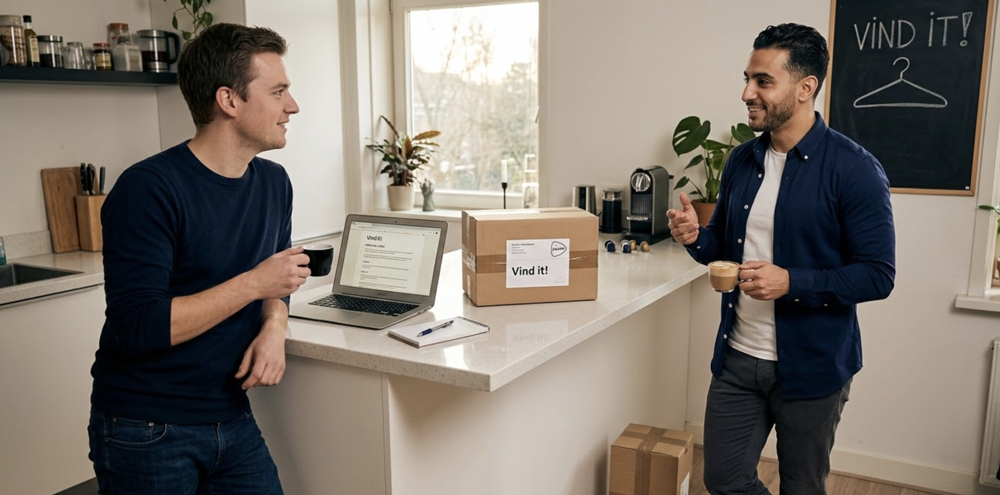

# Verslag interview "Vind it!"

**Datum:** 24 maart 2026  
**Interviewer:** Sam de Vries (Student ICT)  
**Geïnterviewde:** Mo El-Amrani (Opdrachtgever - tweedehands verkoper)  

---

### Het Interview

**Sam:** "Hé Mo, goed dat we even kletsen. Je wilde iets met een database voor je dingetjes die je verkoopt, toch? Ik zag je laatst op de gang ook al met een stapel pakketjes lopen."

**Mo:** "Pff, hou op schei uit. Het is echt uit de hand gelopen man. Ik was begonnen met wat oude studieboeken van vorig jaar, maar nu struikel ik in mijn kamer over de dozen met vintage kleding en oude elektronica. Het is een zootje. Ik weet oprecht niet meer of ik nou winst maak of dat ik alleen maar PostNL aan het sponsoren ben."

**Sam:** "Je kamer staat dus vol en je bent het overzicht kwijt. Je wilt eigenlijk weten of al dat werk onderaan de streep wel iets oplevert?"

**Mo:** "Ja, precies dat! Kijk, die apps zoals Vinted zijn leuk, maar die laten alleen zien wat je per item vangt. Ik wil een eigen systeem waar ik gewoon alles in knal. En dan bedoel ik ook écht alles. Als ik een keer een oude PlayStation-controller verkoop, moet dat er ook in kunnen, niet alleen kleding."

**Sam:** "Helder. Dus het gaat niet alleen om kleding en boeken, maar ook om die andere categorieën. Hoe zie je dat voor je als je iets verkoopt? Moet ik dan aan een soort logboek denken?"

**Mo:** "Ja, en het zou chill zijn als ik ook even kan zien welke categorieën ik al eerder gebruikt heb. Anders typ ik straks de ene keer 'boek' en de andere keer 'boeken' en wordt het weer een zooitje."

**Sam:** "Dus naast filteren op kleding, boeken en overig wil je ook een simpel overzicht van alle gebruikte categorieën, zodat je consequent invoert."

**Mo:** "Ja, zoiets. Ik wil gewoon de datum en de tijd invullen, want soms verkoop ik drie dingen op een avond en weet ik niet meer wanneer ik nou ook alweer wat verkocht heb. En natuurlijk wat het heeft opgeleverd."

**Sam:** "Wacht, even kijken of ik het goed heb: je wilt het moment van verkoop opslaan — dus datum en tijd — en het bedrag. En dan per categorie kunnen zien wat er gebeurt?"

**Mo:** "Kijk, jij snap het. Ik wil vooral die kleding en boeken apart kunnen zien, want dat doe ik het meest. De rest mag op één grote hoop, 'overige' ofzo. Maar ik moet wel aan het eind van de maand op een knop kunnen drukken en zien: 'Mo, je hebt nu 140 euro verdiend deze maand'. Dat geeft rust."

**Sam:** "Dat totaaloverzicht is dus cruciaal voor je rust. Nou weet ik niet echt zeker of ik al overzichten kan maken voor een bepaalde maand of zo, dat moet ik even uitzoeken. Zou een totaaloverzicht van al je verkopen ook al helpen in de eerste versie? Dan kan ik per maand of zo later altijd nog toevoegen als ik die lessen heb gehad.

**Mo:** "Ja, relax man, dat is al meer dan ik nu heb, dus dat zou al fijn zijn! En als het later per maand of per jaar kan, zou dat mooi zijn. Maar laten we eerst maar eens zorgen dat ik überhaupt een overzicht heb van wat er allemaal verkocht is en wat het heeft opgeleverd. En dan kunnen we altijd nog uitbreiden."

**Sam:** "Fine, doen we dat. En qua techniek? Moet het in de cloud ofzo?"

**Mo:** "Nee man, ben je gek! Dat is mijn data. Ik wil niet dat een of ander bedrijf meekijkt met wat ik verdien. Het moet gewoon op mijn eigen Linux-bakje draaien dat ik thuis heb staan. Lekker veilig, lokaal. Als ik die computer uitzet, moet die data er de volgende dag natuurlijk nog wel zijn."

**Sam:** "Haha, gelukkig, want die cloud, dat had ik nu ook niet niet echt gekund eerlijk gezegd, komt dus goed uit! Maar je wil dus volledige controle over de hardware en de opslag, zodat je privacy gewaarborgd is en de data bewaard blijft. Is er nog iets waar ik rekening mee moet houden? Iets wat ik nu vergeet?"

**Mo:** "Nou... het moet wel simpel blijven hè. Ik ben geen programmeur. Gewoon een menuutje waar ik een getal kies en dan mijn ding doe. En als ik een foutje maak bij het typen van het bedrag, moet de boel niet meteen ontploffen. Maar goed, jij bent de ICT'er, dat fix je wel toch?"

**Sam:** "Ik ga ermee aan de slag, Mo. Ik bouw een lokaal systeem voor je, 'Vind it!', waarbij je verkopen per categorie kunt inzien en we rekenen alles netjes uit."

**Mo:** "Top. Ik ga weer eens wat pakketjes wegbrengen. Succes man!"