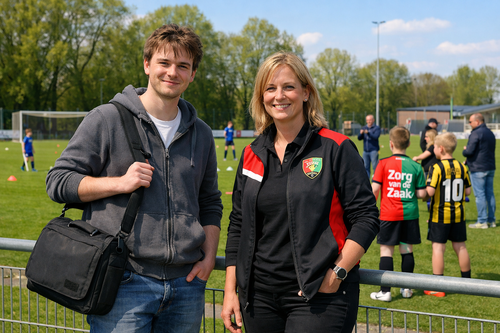

# Verslag interview Elftalbeheer

**Datum:** 7 april 2026  
**Interviewer:** Ruben van Dijk (ontwikkelaar - student ICT)  
**Geinterviewde:** Marit van Rheden (bestuurslid technische zaken - VV Finecce)

---

### Het Interview

**Interviewer:** "Bedankt dat u tijd heeft, mevrouw Van Rheden. U gaf aan dat jullie als club behoefte hebben aan een applicatie voor elftalbeheer. Wat gaat er nu in de praktijk mis?"

**Bestuurslid:** "We werken nu met losse lijstjes, appjes en af en toe een spreadsheet. Daardoor hebben we geen centraal overzicht van welke spelers in welk elftal zitten. Vooral bij de jeugd gaat dat fout, omdat leeftijdsgrenzen daar belangrijk zijn. We mogen namelijk niet zomaar spelers in een elftal zetten: dat mag alleen als ze onder een bepaalde leeftijd zijn. En fout gaan willen we natuurlijk voor zijn. Het is erg vervelend als we er pas op het voetbalveld achter komen dat een speler niet in de juiste leeftijdscategorie zit. Meestal worden de spelertjes niet van het veld gestuurd als ontdekt wordt dat ze net te oud zijn, maar het is eigenlijk niet volgens de regels natuurlijk, en soms levert het echt vervelende situaties op."

**Interviewer:** "Als ik het goed samenvat: jullie missen een centrale plek waar per elftal de spelers staan, en vooral de leeftijdscontrole is cruciaal in de jeugd. Klopt dat?"

**Bestuurslid:** "Ja, precies. Als daar al rust in komt, is dat voor ons de grootste winst."

**Interviewer:** "Welke informatie wilt u minimaal per elftal en per speler opslaan?"

**Bestuurslid:** "Per elftal willen we een code, een omschrijving, de naam van de coach en een maximumleeftijd. Per speler willen we in elk geval naam, leeftijd, positie en aan welk elftal die gekoppeld is."

**Interviewer:** "Wat voor code is dat dan?"

**Bestuurslid:** "Dat is een korte code die we gebruiken om de leeftijdsklasse aan te geven en om welk soort team het gaat, bijvoorbeeld 'JO11-1' voor het eerste elftal met jongens onder 11 jaar, MO13-1 voor meiden onder de 13 en JMO16-2 voor het tweede teams met jongens en meiden onder de 16 jaar. Die naamgeving komt van de KNVB, dus dat is een standaard die we al gebruiken. We willen die code graag in de app terugzien, zodat het meteen duidelijk is om welk elftal het gaat."

**Interviewer:** "Helder, dan hebben we dus meteen een unieke code voor elk team te pakken, dat is handig voor in de database. U noemt positie ook expliciet. Wilt u vrije tekst invoeren, of liever een vaste lijst?"

**Bestuurslid:** "Graag een vaste lijst. Anders krijg je straks 'spits', 'aanvaller' en 'centrumspits' door elkaar en wordt het rommelig."

**Interviewer:** "Duidelijk, dus datakwaliteit is belangrijk. Dan check ik meteen: moet de app spelers blokkeren die ouder zijn dan de maximumleeftijd van een elftal, of alleen een waarschuwing geven?"

**Bestuurslid:** "Bij invoer liever blokkeren, anders gaat het toch fout. Maar daarnaast zou ik graag een aparte controlefunctie willen die het hele bestand naloopt en opvallende gevallen meldt."

**Interviewer:** "Dus twee niveaus: direct valideren bij invoer en daarnaast periodiek controleren op afwijkingen. Dat noteer ik als hoge prioriteit."

**Bestuurslid:** "Ja, dat is voor ons prioriteit nummer 1."

**Interviewer:** "Welke handelingen moeten medewerkers in de eerste versie sowieso kunnen doen?"

**Bestuurslid:** "Elftallen bekijken, elftallen toevoegen, spelers toevoegen, spelers verwijderen, en de gemiddelde leeftijd per elftal zien. Dat gemiddelde gebruiken we in overleggen met trainers."

**Interviewer:** "Wilt u bij verwijderen van een speler alleen op naam zoeken, of moet dat bijvoorbeeld ook op combinatie naam plus elftal?"

**Bestuurslid:** "Goede vraag. In de eerste versie mag het op naam, maar eigenlijk willen we op termijn naam plus elftal. We hebben namelijk twee keer een 'Daan Jansen' gehad."

**Interviewer:** "Helder, dan leg ik vast: nu eenvoudig verwijderen, later verfijnen om vergissingen te voorkomen."

**Bestuurslid:** "Ja, precies zo."

**Interviewer:** "Oke, duidelijk. En zijn er ook nog dingen die u nu nog niet nodig heeft, maar die in een latere fase wel handig zouden zijn?"

**Bestuurslid:** "Poeh, daar overval je me nu een beetje mee, maar ik denk misschien aan iets van rapportages en exporteren."

**Interviewer:** "Rapportages en export, wat bedoelt u dan precies?"

**Bestuurslid:** "Bijvoorbeeld een export naar een Excelbestand of een ander soort spreadsheet-achtig bestand van alle spelers per elftal. Dan kunnen we het delen met trainers of meenemen naar een bespreking zonder direct in het systeem te hoeven werken."

**Interviewer:** "Zijn er ook ideeën die de betrokkenheid bij de club kunnen vergroten?"

**Bestuurslid:** "Ja, graag zelfs. Het zou leuk zijn als het systeem af en toe een willekeurige speler als 'speler van de maand' kan aanwijzen. Dat hoeft niet te onthouden te worden in de applicatie; wij houden zelf wel bij of iemand al eens eerder gekozen is."

**Interviewer:** "En kan de applicatie ook helpen bij het kiezen van een passend elftal voor een nieuwe speler?"

**Bestuurslid:** "Ja, graag zelfs. Als iemand een speler invoert, zou het systeem een suggestie mogen geven voor een team. Het systeem gaat dan door de lijst van elftallen, gesorteerd op maximumleeftijd, van hoog naar laag, en dan net zo lang doorzoeken tot je een team vindt waarvoor de speler jong genoeg is. Een controle op jongen/meisje hoeft nu nog niet; dat zou later nog een mooie uitbreiding zijn."

**Interviewer:** "Duidelijk. Zijn er nog andere wensen die nu nog niet hoeven, maar wel interessant zijn als vervolg?"

**Bestuurslid:** "Ja, een paar. Een zoekfunctie op spelernaam, een overzicht van hoeveel spelers per positie in elk elftal zitten, en een seizoenslabel zodat je later kunt terugkijken. Misschien ook een simpele melding als een elftal te weinig spelers heeft voor een wedstrijdselectie."

**Interviewer:** "Even checken of ik niets invul namens u: met 'te weinig spelers' bedoelt u dat de app een ondergrens hanteert die wij per elftal kunnen instellen, toch?"

**Bestuurslid:** "Ja, precies. Niet hardcoded, maar instelbaar. Voor een niet-voetballer klinkt dat misschien wat gek, maar een elftal heeft niet altijd elf spelers. Voor een jeugdelftal kan dat anders liggen dan voor senioren. En o ja, reservespelers hoeven nu nog niet meegeteld te worden in het geheel, het gaat om de basisspelers. Later kunnen we dat misschien uitbreiden, maar voor nu is het voldoende als we alleen de basisspelers in de gaten houden."

**Interviewer:** "Helder. En qua omgeving: moet dit in de cloud of lokaal draaien?"

**Bestuurslid:** "Lokaal. We zijn een kleine club en willen geen gedoe met externe diensten. Het moet op een club-pc kunnen draaien en de data moet na afsluiten gewoon bewaard blijven."

**Interviewer:** "Begrijpelijk. Nog een laatste check: hoeveel mensen gebruiken het systeem tegelijk?"

**Bestuurslid:** "Voor nu meestal een persoon tegelijk. Als later meerdere mensen tegelijk willen werken, is dat een vervolgstap."

**Interviewer:** "Dank, dan vat ik samen wat ik meeneem voor de eerste versie: een lokale CLI-app met databaseopslag waarin we elftallen en spelers beheren, met vaste posities, strikte leeftijdscontrole bij invoer, overzichten per elftal en basisstatistiek zoals gemiddelde leeftijd. Daarna kunnen we uitbreiden met export, zoeken, bezettingsrapportages en seizoenshistorie."

**Bestuurslid:** "Ja, dat is precies wat we nodig hebben. Als die basis stabiel staat, kunnen we echt professioneler werken."

**Interviewer:** "Terwijl we bezig zijn bedenk ik me ineens dat ik niet precies weet hoe ik op basis van een geboortedatum de leeftijd van een speler moet uitrekenen. Is het goed als we in de eerste versie van de app gewoon de leeftijd als getal invoeren, en dat we later een automatische berekening toevoegen op basis van geboortedatum?"

**Bestuurslid:** "Ja, dat is prima. We kunnen de leeftijd voorlopig gewoon handmatig invoeren. Later kunnen we dat inderdaad automatiseren, maar voor nu is het voldoende als we het als getal invoeren. Als we niet al te lang wachten met de volgende versie, dan zal een speler in elk geval niet meer dan 1 jaar te oud zijn!"