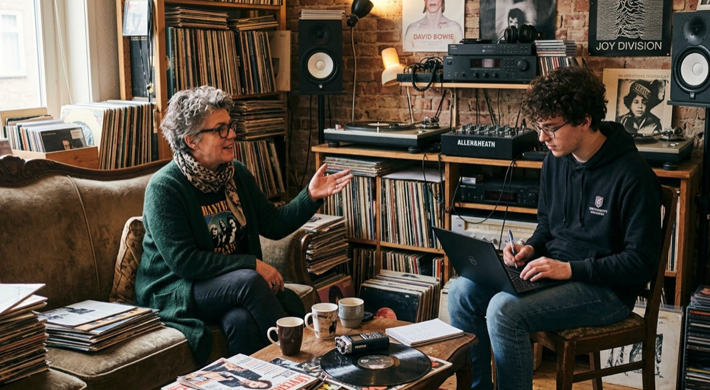

# Verslag interview De Platenbak

**Datum:** 17 augustus 2026  
**Interviewer:** Tijs Veroost (ontwikkelaar - student ICT)
**Geïnterviewde:** Wilma van Kooten (opdrachtgever - vinylliefhebber en DJ)

---

### Het Interview

**Interviewer:** "Hallo Wilma, we gaan het vandaag hebben over jouw idee voor een applicatie om je enorme muziekcollectie beter te kunnen beheren. Wat is voor jou het grootste probleem op dit moment?"

**Opdrachtgever:** "Kijk, ik heb duizenden tracks op verschillende platen en cd's staan, maar ik raak het overzicht volledig kwijt. Kijk maar 'ns om je heen: er is echt veel! Daarom wil ik graag een systeem hebben waarin ik elk nummer los kan registreren. Ik wil niet alleen weten hoe een nummer heet, maar ook van welke artiest het is, hoe lang het duurt en uit welk jaar het komt. Dat is de basis. Als dat er allemaal is, denk ik dat de applicatie me kan helpen om bijvoorbeeld specifieke nummers te vinden."

**Interviewer:** "Duidelijk, de focus ligt dus echt op het registreren van individuele tracks. Hoe ga je om met de invoer van die gegevens? Is daar iets belangrijks waar ik op moet letten?"

**Opdrachtgever:** "Ja, ik ben nogal een perfectionist. Ik wil dat de data 'schoon' blijft. Het zou vreselijk zijn als ik de ene keer 'Techno' invul en de andere keer 'Tekno', want dan raak ik het overzicht alsnog kwijt. Ik wil dat het systeem me dwingt om te kiezen uit artiesten en genres die ik al eerder heb vastgelegd. Als ik iets nieuws invoer wat niet klopt, moet de app me gewoon even waarschuwen en dan probeer ik het nog wel een keer. Hetzelfde geldt trouwens voor artiesten: ik moet altijd alleen nummers kunnen invoeren van artiesten die al bekend zijn. En ja, dan is het wel handig als ik ook artiesten kan toevoegen, al begrijp ik dat je mijn collectie ook al meteen kunt invoeren met een soort automatisch lijstje of zo, toch? Ach ja, mijn collectie is al zo breed dat bijna alle artiesten waarin ik geïnteresseerd ben er toch al in zitten, dus invoeren van nieuwe artiesten hoeft eigenlijk niet meteen te kunnen."

**Interviewer:** "Ja, ik kan je huidige collectie met een insert alvast in de database zetten, dus dan staan die artiesten er inderdaad allemaal in. Maar als ik je goed begrijp, wil je dus eigenlijk een stukje kwaliteitscontrole bij de invoer? En hoe zit dat dan met genres, moeten die ook kunnen worden toegevoegd?"

**Opdrachtgever:** "Nee, ik ben niet zo hip dat ik nu nog nieuwe genres ga toevoegen. Ik kan me voorstellen dat dat voor de compleetheid wel zou moeten misschien, maar van mij hoeft het echt niet hoor! En verwijderen en zo ook niet."

**Interviewer:** "Duidelijk. Je noemde eerder ook dat je de app wilt gebruiken voor de voorbereiding van je DJ-sets. Hoe zie je dat voor je?"

**Opdrachtgever:** "Dat is mijn grootste wens: de 'playlist-hulp'. Had ik al verteld dat ik mijn eigen programma heb bij de lokale omroep? Soms heb ik in mijn set nog 8 of 10 minuten over. Ik wil dan dat ik de app kan vragen: 'Geef me een willekeurige lijst met nummers uit mijn bak die samen binnen die tijd passen'. Dan hoef ik zelf niet meer te puzzelen met seconden en minuten terwijl ik aan het draaien ben. En ik heb liever dat de lijst net iets te lang is dan te kort, want dan weet ik zeker dat ik de tijd kan vullen en draai ik 't laatste nummer eventueel gewoon wat eerder weg."

**Interviewer:** "Dat bespaart inderdaad een hoop rekenwerk. Wil je naast dat overzicht ook nog andere inzichten uit je collectie kunnen halen?"

**Opdrachtgever:** "Absoluut. Ik wil graag statistieken zien. Hoeveel nummers heb ik in totaal? Wat is de gemiddelde duur van mijn tracks? En ik ben ook benieuwd naar de verdeling: hoeveel tracks heb ik per genre en waar komen mijn artiesten vandaan? Dat helpt me om te zien hoe gevarieerd mijn collectie is. En ik wil ook graag makkelijk de nummers kunnen vinden uit een bepaald genre vanaf een specifiek jaar. Soms heb ik zin om naar muziek uit een bepaald genre en een bepaalde periode te luisteren. Het lijkt me echt vet als de tool me naarbij kan helpen. Niet Tool de band, haha!"

**Interviewer:** "Helder. En hoe zit het met de opslag van al die gegevens? Heb je daar nog specifieke eisen voor? Moet het bijvoorbeeld in de cloud of zo?"

**Opdrachtgever:** "Het moet gewoon goed op mijn eigen laptop draaien. Die neem ik ook mee naar de studio van de omroep, en daar is de wifi echt om te huilen, dus het moet allemaal zonder internetverbinding werken. Ik ben de enige die het systeem gaat gebruiken, dus er hoeft ook niet iemand van buiten bij te kunnen of zo."

**Interviewer:** "Logisch. En is er verder nog iets?"

**Opdrachtgever:** "Ja, ik word natuurlijk heel blij van tussen mijn platen en cd's zitten en er lekker in te snuffelen, kun je daar een digitale tegenhanger van maken? Gewoon een functie die alle tracks uit het systeem onder elkaar in een rijtje zet? Lijkt me heerlijk om een beetje doorheen te scrollen en zo inspiratie op te doen. En verder zou ik het nog wel geinig vinden als ik iets van een melding krijg over hoeveel nummers ik heb toegevoegd en verwijderd als ik het programma afsluit. Dan heb ik het gevoel dat ik weer lekker bezig ben geweest. Misschien niet echt een kern-functie, dus kijk maar of het lukt. Ik zou het wel leuk vinden hoor: ik houd niet alleen van muzieknummers, maar ook van nummers in de betekenis van getallen!"

**Interviewer:** "Haha, ja, dat snap ik. Ik denk dat ik nu een goed beeld heb van je wensen, Wilma. Een systeem dat tracks beheert met strikte controle op artiesten en genres, statistieken biedt en je helpt bij het vullen van tijdsloten in je sets. Ik ga hiermee aan de slag!"

**Opdrachtgever:** "Mieters!"