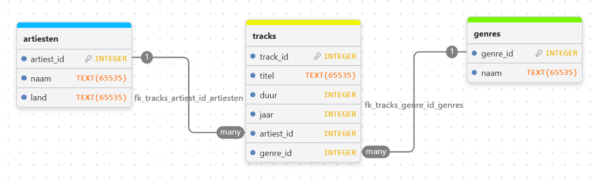

# Ontwerp Platenbak

## Inleiding

Dit document beschrijft het ontwerp van Platenbak. Dit ontwerp biedt de technische basis voor de realisatie van de applicatie.

## Technische eisen

- De applicatie moet geschreven zijn in Python.
- De applicatie moet gebruik maken van een SQLite-database voor het opslaan van gegevens.
- De applicatie moet een command-line interface (CLI) hebben voor interactie met de gebruiker.

## Tabelontwerp

## Afhankelijkheden

De applicatie "Platenbak" is afhankelijk van de volgende bibliotheek:

- `sqlite3`: Voor het beheren van de SQLite-database.

## Functies

De applicatie "Platenbak" bestaat uit de volgende functies:

### Database-verbinding

- `maak_verbinding()`: Maakt verbinding met een SQLite-database en
  retourneert deze verbinding.

### Model-functies (datalaag)

- `voeg_track_toe_aan_database(verbinding, artiest, titel, duur, jaar, genre)`:
  Voegt een track toe aan de database. De functie krijgt de
  databaseverbinding en de gegevens van de track mee en retourneert niets.

- `verwijder_track_uit_database(verbinding, artiest, titel)`: Verwijdert
  een track uit de database.

- `haal_statistieken_op_uit_database(verbinding)`: Haalt statistieken op
  over de collectie.

- `haal_landen_op_uit_database(verbinding)`: Haalt landen met aantallen
  artiesten op.

- `zoek_tracks_op_criteria_uit_database(verbinding, genre, jaar_min)`:
  Zoekt tracks op genre en minimaal jaar.

- `haal_genreoverzicht_op_uit_database(verbinding)`: Haalt het
  genre-overzicht op.

- `track_bestaat_in_database(verbinding, artiest, titel)`: Controleert of
  een track met gegeven artiest en titel bestaat.

### Presentatie-functies (view/controller)

- `toon_menu()`: Toont het menu van de applicatie. De functie heeft geen
  parameters en retourneert niets.

- `vraag_keuze()`: Vraagt de gebruiker om een keuze uit het menu.
  De functie heeft geen parameters en retourneert de keuze als een getal.

- `toon_track_info(track)`: Toont de informatie van een track.
  De functie krijgt de informatie over de track mee als parameter en
  retourneert niets.

- `voeg_track_toe(verbinding)`: Vraagt de gebruiker om de gegevens van
  een nieuwe track. De functie krijgt de databaseverbinding mee en vraagt
  om artiest, titel, duur, jaar en genre. Daarna roept deze functie
  `voeg_track_toe_aan_database()` aan.

- `verwijder_track(verbinding)`: Vraagt welke track verwijderd moet
  worden en voert dat uit.

- `stel_playlist_samen(verbinding)`: Stelt een playlist samen op basis van een
  ingestelde duur.

- `toon_statistieken(verbinding)`: Toont statistieken over de collectie.

- `toon_landen(verbinding)`: Toont landen met aantallen artiesten.

- `zoek_tracks(verbinding)`: Zoekt tracks op criteria en toont
  resultaten.

- `toon_genreoverzicht(verbinding)`: Toont het genre-overzicht.

### Hoofdfunctie

- `start_platenbak()`: Start de hoofdloop en handelt gebruikersinvoer af.