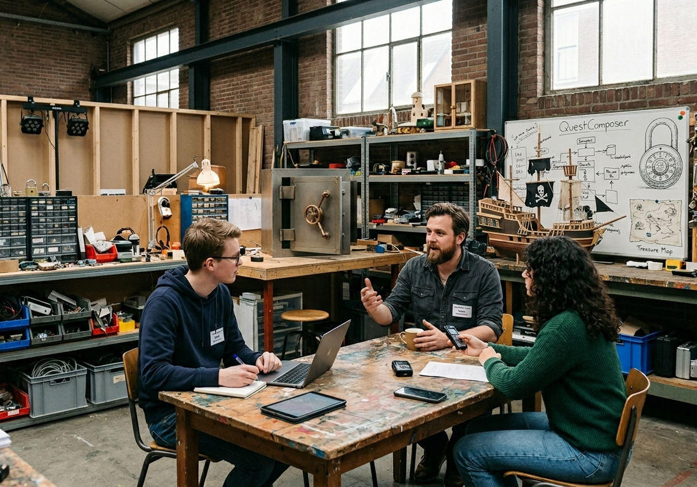

# Interviewverslag: Ontwikkeling QuestComposer

**Datum:** 9 april 2026  
**Interviewers:** Niels van der Linden en Myrthe Elissen (studenten ICT) 
**Geinterviewde:** Robin Vermeer (Opdrachtgever, Escaperoom-ontwerper bij Labyrinth Studios)
**Locatie:** Bij Labyrinth Studios



---

### Het Interview

**Vraag:** Kun je iets vertellen over Labyrinth Studios en jouw rol daar?

**Antwoord:** Labyrinth Studios is acht jaar geleden gestart als klein ontwerpcollectief met twee makers en een decorbouwer. Inmiddels zijn we met twaalf mensen: drie ontwerpers, vier technische bouwers, twee decorbouwers, een productiecoordinator, een licht- en geluidspecialist en een stagiairenteam dat meedraait in piekperiodes. We leveren zowel permanente kamers voor vaste locaties als mobiele pop-up rooms voor onderwijs, open dagen en bedrijfsfestivals. Mijn rol is lead designer. Ik schrijf scenario's, zet puzzellijnen uit, bewaak de moeilijkheidscurve en stem met productie af welke onderdelen haalbaar zijn qua tijd en budget.

In de praktijk loopt dat proces niet lineair. We hebben vaak eerst een creatief idee, dan een technische reality check, dan opnieuw een designronde. Daardoor ontstaan veel losse lijstjes: in notitieblokken, op whiteboards, in spreadsheets en in Slack-threads. Op papier werkt dat nog net bij kleine projecten, maar bij drie scenario's tegelijk raken we overzicht kwijt. Vooral budgetafspraken per scenario verdwijnen dan naar de achtergrond.

Daarnaast werken we met verschillende leveranciers met uiteenlopende levertijden en transportkosten. In sommige weken kopen we veel klein materiaal in, in andere weken juist een paar duurdere kernonderdelen. Zonder centraal overzicht zie je niet meer goed wat essentieel is voor de eerste speelbare versie.

**Vraag:** Wat moet de kern van deze tool worden?

**Antwoord:** Overzicht, haalbaarheid en grip op kosten. We willen puzzelonderdelen per scenario registreren, bijvoorbeeld voor scenario's als "Bankoverval", "Ruimtestation" of "Horrorzolder". Elk onderdeel moet een prijs hebben, gekoppeld zijn aan een leverancier en een prioriteit krijgen. Zo kunnen we gericht bouwen en inkopen, zonder dat we steeds terugvallen op losse bestanden.

**Vraag:** Kun je het hoofdprobleem nog scherper formuleren? Wat moet deze tool echt oplossen?

**Antwoord:** Het hoofdprobleem is dat creatieve ideeen vaak sneller gaan dan de reality check. Ontwerpers bedenken iets tofs, maar zien te laat dat het financieel of logistiek niet haalbaar is binnen de beschikbare tijd en het scenario-budget. Deze tool moet dus heel duidelijk helpen bij de vraag: "Is dit idee realistisch om te bouwen met ons budget en onze planning?" Als dat antwoord nee is, moeten we dat vroeg zien, niet pas in de week van de speeltest.

Concreet moet de app drie dingen afdwingen: een compleet onderdelenoverzicht per scenario, actuele kostprijzen inclusief transport, en directe signalering bij budgetoverschrijding. Als dat goed werkt, voorkom je dat teams op basis van onderbuikgevoel gaan bouwen.

**Vraag:** Heb je een voorbeeld van een moment waarop dit bijna misging?

**Antwoord:** Jazeker, en daar lachen we nu om, maar op dat moment was het minder grappig. We hadden voor een pop-up room een "spectaculaire" eindpuzzel bedacht met een rookeffect, magneetsloten, DMX-licht en een audiocue. In een spreadsheet had iemand heel netjes alles opgeteld, alleen de transportkosten stonden in een verborgen kolom die niet meefilterde in het totaal. Op papier zaten we op 1.980 euro, dus ruim onder het budget van 2.100. In werkelijkheid kwamen we boven de 2.400 uit.

Het werd ontdekt toen de productiecoordinator riep: "Waarom kost deze rookmachine ineens meer dan mijn eigen scooter?" Bleek dat er spoedverzending en twee losse zendingen bij waren gekomen. We hebben toen last-minute onderdelen moeten schrappen en een decorstuk met ducttape "tijdelijk permanent" gemaakt. Publiek merkte het gelukkig niet echt, maar intern was het een wake-up call.

QuestComposer moet precies dat soort blunders voorkomen: niet achteraf repareren, maar vooraf inzichtelijk maken of een ontwerpidee realistisch uitvoerbaar is.

**Vraag:** Welke handelingen moeten gebruikers in ieder geval kunnen doen?

**Antwoord:** Ze moeten onderdelen kunnen toevoegen, verwijderen en prijzen kunnen bijwerken. Prijzen veranderen snel en we willen steeds met actuele data rekenen.

**Vraag:** Jullie gebruiken nu al spreadsheets. Moet import ondersteund worden?

**Antwoord:** Ja, graag. In intakefases gebruiken we vaak CSV-overzichten uit brainstormsessies en workshops. Soms komen die bestanden van docenten, soms van stagiairs, soms uit een export van een projecttool. Het zou handig zijn als je zo'n bestand direct kunt inladen. Als een leverancier of scenario nog niet bestaat, mag die automatisch aangemaakt worden met standaardwaarden. Dat scheelt veel handwerk en voorkomt dat iemand handmatig twintig regels overtypt.

We krijgen vaak bestanden met net andere kolomnamen, afhankelijk van wie het exporteert. Daarom is het prettig als de app daar redelijk mee om kan gaan zolang de kernvelden aanwezig zijn. Voor de eerste versie hoeft dat niet extreem slim te zijn, maar het moet wel praktisch genoeg zijn voor onderwijsprojecten.

We werken soms met externe schijven en gescheiden opslagomgevingen (bijvoorbeeld USB’s of aparte projectschijven). De tool moet daar zonder problemen mee kunnen werken.

**Vraag:** Je noemde kostenbewaking. Hoe wil je dat terugzien?

**Antwoord:** In het overzicht willen we de echte totaalkosten zien: onderdeelprijs plus transportkosten van de leverancier. Veel teams kijken alleen naar de prijs van het onderdeel en vergeten transport.

**Vraag:** Hoe wil je met budgetten werken?

**Antwoord:** Per scenario stellen we een budget in. We verdelen dat intern vaak over fasen: een proefopstelling, een eerste speeltest en een definitieve bouw. Voor deze versie is een budget per scenario voldoende, zolang we maar goed kunnen zien hoeveel onderdelen erin zitten, wat goedkoop en duur is, wat gemiddeld kost, wat het totaal is en of we over budget gaan. Dat geeft direct stuurinformatie in sprint-overleggen.

**Vraag:** Moet de tool een webapp zijn?

**Antwoord:** Nee, liever niet voor deze fase. Een lokale terminalapp is prima. We willen een betrouwbare basisversie die studenten kunnen bouwen en testen. Later kunnen we eventueel kijken naar een GUI of weblaag, maar dat is nu niet nodig. Voor ons is belangrijker dat data consequent en correct wordt verwerkt.

**Vraag:** Moet iedereen die de computer opent dan meteen in de tool kunnen, of willen jullie daar nog iets van afscherming op?

**Antwoord:** Liefst wel een eenvoudige afscherming. Niet omdat hier staatsgeheimen in staan, maar wel omdat we in onderwijssettings en gedeelde werkplekken werken. Dan is het prettig als niet iedereen direct de tool in kan. Een simpele toegangscode bij het opstarten is voor deze fase voldoende. Die moet natuurlijk wel aan moderne veiligheidsnormen voldoen.

**Vraag:** Zijn er extra functies die het gebruik praktischer maken?

**Antwoord:** Twee dingen. Ten eerste zoeken op budgetrange, bijvoorbeeld "toon alles tussen 20 en 60 euro". Dat helpt tijdens keuzesessies waarin we snel willen weten welke alternatieven haalbaar zijn met restbudget. Ten tweede een eenvoudig inkoopritme per onderdeel. Sommige onderdelen zijn duur; dan willen we weten hoeveel budget we per maand moeten opbouwen om op tijd klaar te zijn voor een testweek.

**Vraag:** Hoe belangrijk is datakwaliteit?

**Antwoord:** Heel belangrijk. Leveranciers en scenario's moeten consistent blijven. Ook willen we prioriteiten kunnen meegeven, liefst in schaal 1 tot 3, zodat kernonderdelen niet verdwijnen tussen bijzaken. Een onderdeel met prioriteit 1 moet je kunnen herkennen als iets dat nodig is om de kernloop van het scenario te laten werken.

**Vraag:** Nog iets dat motiverend werkt voor gebruikers?

**Antwoord:** Ja, bij afsluiten graag een kort sessieoverzicht. Bijvoorbeeld hoeveel onderdelen in die sessie zijn toegevoegd en verwijderd.

**Vraag:** Is er nog context die niet direct functioneel is, maar wel helpt om de opdracht realistischer te maken?

**Antwoord:** Zeker. We draaien vaak parallelle projecten met kleine teams waarin rollen wisselen. De ene student denkt vooral in verhaalbeleving, de ander in elektronica of logistiek. Daardoor krijg je veel verschillende invalshoeken op dezelfde data. Een tool die dwingt tot structuur helpt niet alleen technisch, maar ook in communicatie tijdens reviews. Voor de opdracht mag dat best voelbaar zijn in de context, ook al heb je niet alle details nodig om de app te bouwen.

---

## Nagestuurd door Robin per e-mail:

To: Docententeam ICTJOU  
From: Robin Vermeer <robin@labyrinthstudios.nl>  
Subject: Voorbeeldbestand voor QuestComposer

Beste team,

Zoals beloofd hierbij een klein CSV-voorbeeld met onderdelen die we vaak gebruiken in conceptfases. Als dit direct in de applicatie geladen kan worden, scheelt dat ons veel invoerwerk.

Extra context: dit bestand komt uit onze "vrijdag-intake" waarin ontwerp, techniek en productie gezamenlijk snel een eerste shortlist maken. In de praktijk zit daar vaak ruis in (onvolledige regels, onderdelen die later afvallen, tijdelijke leveranciersnamen). Dat is normaal in vroege projectfases.

Groet,
Robin Vermeer
Labyrinth Studios

```text
titel,prijs,leverancier,scenario,prioriteit
Code-slot,89.00,EscapeParts,Bankoverval,1
UV-lamp,24.95,PuzzelShop,Labgeheim,2
Verborgen scharnier,13.50,DecorMakers,Piratenkamer,3
Rookmachine mini,59.99,TechStage,Horrorzolder,2
Microcontroller,34.75,ElektronicaHub,Labgeheim,1
```
