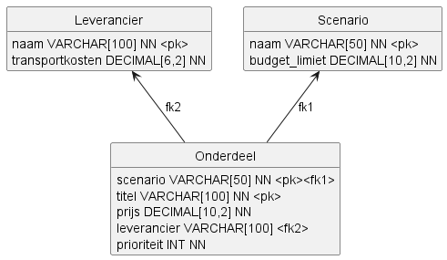
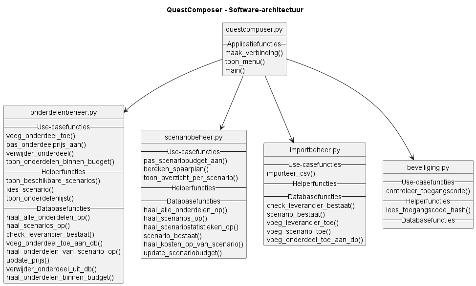

# Ontwerp QuestComposer

## Inleiding

Dit document beschrijft het ontwerp van QuestComposer. Dit ontwerp biedt de technische basis voor de realisatie van de applicatie.

## Technische eisen

### TE1. Data-integriteit
De applicatie maakt gebruik van een SQLite-database. Tabellen worden voorzien van primaire sleutels en waar nodig vreemde sleutels om relaties tussen scenario's en onderdelen af te dwingen. Budgetwaarden worden opgeslagen als numerieke datatypes en invoer wordt gevalideerd voordat deze wordt opgeslagen.

### TE2. Toegangsbeveiliging
Bij het opstarten van de applicatie moet de gebruiker een toegangscode invoeren. Alleen na succesvolle verificatie wordt toegang verleend tot de functionaliteiten van de applicatie.

### TE3. Bescherming van gevoelige configuratie
Gevoelige configuratiegegevens worden opgeslagen in een `.env`-bestand. Dit bestand wordt opgenomen in `.gitignore`, zodat het niet in versiebeheer terechtkomt. De applicatie leest deze waarden in via omgevingsvariabelen.

### TE4. Veilige opslag van toegangscode
De toegangscode wordt niet in platte tekst opgeslagen. Voor opslag en verificatie wordt een cryptografische hashfunctie gebruikt, zoals bcrypt of Argon2.

### TE5. Gebruikersinterface
De applicatie biedt een command-line interface (CLI) met duidelijke menuopties, invoerprompts en foutmeldingen. De gebruiker moet scenario's en onderdelen kunnen beheren zonder kennis van de interne datastructuur.

### TE6. Uitbreidbaarheid
De software wordt modulair opgebouwd met een scheiding tussen gebruikersinterface, bedrijfslogica en datalaag. Nieuwe functionaliteiten moeten kunnen worden toegevoegd zonder grote wijzigingen aan bestaande componenten.

### TE7. Budgetcontrole en haalbaarheidsanalyse
De applicatie berekent automatisch de totale kosten van een scenario op basis van de gekoppelde onderdelen. Tijdens het aanmaken of wijzigen van een scenario wordt het beschikbare budget vergeleken met de berekende kosten en wordt direct een melding gegeven wanneer het budget wordt overschreden.

### TE8. Uitvoerbaarheid
De applicatie wordt ontwikkeld in Python 3 en kan vanaf een standaard Linux-omgeving worden gestart via een terminalcommando. Externe afhankelijkheden worden vastgelegd in een `requirements.txt`-bestand.

### TE9. Gegevensportabiliteit
Bestandslocaties worden niet hardcoded in de broncode. De applicatie werkt met configureerbare bestandspaden en moet gegevens kunnen lezen en schrijven op verschillende opslaglocaties, waaronder andere schijven, externe opslagmedia en gemounte bestandssystemen.

## Database-ontwerp

Het domeinmodel wordt vertaald naar de tabellen `Leverancier`, `Scenario` en `Onderdeel`. De kolommen en sleutels hieronder volgen het gegeven `db/creates.sql`.

### Leverancier

| Kolom | Datatype | Sleutel | Verplicht | Standaardwaarde |
|---|---|---|---|---|
| naam | VARCHAR(100) | PK | Ja | - |
| transportkosten | DECIMAL(6,2) | | Ja | 0.00 |

### Scenario

| Kolom | Datatype | Sleutel | Verplicht | Standaardwaarde |
|---|---|---|---|---|
| naam | VARCHAR(50) | PK | Ja | - |
| budget_limiet | DECIMAL(10,2) | | Ja | - |

### Onderdeel

| Kolom | Datatype | Sleutel | Verplicht | Standaardwaarde |
|---|---|---|---|---|
| scenario | VARCHAR(50) | PK, FK naar Scenario.naam | Ja | - |
| titel | VARCHAR(100) | PK | Ja | - |
| prijs | DECIMAL(10,2) | | Ja | - |
| leverancier | VARCHAR(100) | FK naar Leverancier.naam | Nee | - |
| prioriteit | INT | | Ja | - |

De primaire sleutel van `Onderdeel` bestaat uit `scenario` en `titel`. Daarmee kan dezelfde titel in verschillende scenario's voorkomen. Een scenario kan meerdere onderdelen hebben en ieder onderdeel hoort bij een scenario. De relatie met `Leverancier` is een vreemde sleutel vanuit `Onderdeel.leverancier`.

Het domeinmodel en UC1 gaan uit van een leverancier voor ieder onderdeel. Het gegeven CREATE-script laat bij `Onderdeel.leverancier` echter `NULL` toe. Dit verschil moet worden afgestemd; in dit database-ontwerp is de gegeven SQL gevolgd. `DECIMAL(6,2)` duidt zes cijfers aan, waarvan twee achter de komma. Bij een INSERT zonder `transportkosten` wordt door `DEFAULT 0.00` de waarde 0.00 gebruikt. SQLite dwingt de opgegeven cijferaantallen niet zelf af.

## Afhankelijkheden

De applicatie "QuestComposer" is afhankelijk van de volgende bibliotheken:

- `sqlite3` - Voor het opslaan en ophalen van gegevens in de SQLite-database.
- `csv` - Voor het importeren van onderdelen uit CSV-bestanden.
- `hashlib` - Voor het hashen van de toegangscode.

## Software-architectuur

## Detailontwerp

De applicatie "QuestComposer" bestaat uit de onderstaande elementen.

### Globale variabelen

- `DATABASE` in `questcomposer.py`: Pad naar het SQLite-databasebestand.
- `sessiestatistieken` in `onderdelenbeheer.py`: Dictionary met aantallen toegevoegde en verwijderde onderdelen tijdens de huidige sessie.
- `STANDAARD_TRANSPORTKOSTEN` in `importbeheer.py`: Standaardwaarde (`0.00`) voor transportkosten bij nieuw aangemaakte leveranciers via CSV-import.
- `STANDAARD_SCENARIOBUDGET` in `importbeheer.py`: Standaardbudget (`100.00`) voor nieuw aangemaakte scenario's via CSV-import.

### Functies module "questcomposer.py"

- `maak_verbinding()`: Maakt een SQLite-verbinding met `db/questcomposer.db`, activeert foreign keys en retourneert de verbinding.
- `toon_menu()`: Toont het hoofdmenu en vraagt de gebruiker om een keuze.
- `main()`: Controleert toegangscode, maakt verbinding en stuurt de menu-acties aan.

### Functies module "onderdelenbeheer.py"

- `voeg_onderdeel_toe(verbinding)`: Registreert nieuw onderdeel en verhoogt de sessieteller.
- `pas_onderdeelprijs_aan(verbinding)`: Past prijs van een gekozen onderdeel aan.
- `verwijder_onderdeel(verbinding)`: Verwijdert gekozen onderdeel en verhoogt de sessieteller.
- `toon_onderdelen_binnen_budget(verbinding)`: Toont alternatieven binnen een opgegeven budgetrange.
- `toon_beschikbare_scenarios(verbinding)`: Toont alle scenario's.
- `kies_scenario(verbinding)`: Laat gebruiker een scenario kiezen.
- `toon_onderdelenlijst(verbinding)`: Toont volledige bouwinventaris.
- `haal_alle_onderdelen_op(verbinding)`: Haalt alle onderdelen op inclusief leverancier en scenario.
- `haal_onderdelen_van_scenario_op(verbinding, scenarionaam)`: Filtert onderdelen op scenario.
- `haal_scenarios_op(verbinding)`: Haalt scenario's op met budget.
- `update_prijs(verbinding, scenarionaam, titel, nieuwe_prijs)`: Past onderdeelprijs aan.
- `verwijder_onderdeel_uit_db(verbinding, scenarionaam, titel)`: Verwijdert onderdeel op scenario en titel.
- `voeg_onderdeel_toe_aan_db(verbinding, titel, prijs, leverancier_naam, scenario_naam, prio)`: Voegt onderdeel toe.
- `haal_onderdelen_binnen_budget(verbinding, min_budget, max_budget)`: Haalt onderdelen in budgetrange op.
- `check_leverancier_bestaat(verbinding, leveranciernaam)`: Controleert of leverancier bestaat.

### Functies module "scenariobeheer.py"

- `pas_scenariobudget_aan(verbinding)`: Past budget aan op basis van invoer.
- `bereken_spaarplan(verbinding)`: Berekent inkoopritme voor een gekozen onderdeel.
- `toon_overzicht_per_scenario(verbinding)`: Toont statistieken per scenario met budgetcontrole.
- `haal_alle_onderdelen_op(verbinding)`: Haalt alle onderdelen op inclusief leverancier en scenario.
- `haal_scenarios_op(verbinding)`: Haalt alle scenario's op.
- `haal_scenariostatistieken_op(verbinding)`: Haalt de statistieken per scenario op uit de database.
- `scenario_bestaat(verbinding, scenarionaam)`: Controleert of scenario bestaat.
- `haal_kosten_op_van_scenario(verbinding, scenarionaam)`: Haalt prijzen en transportkosten binnen een scenario op.
- `update_scenariobudget(verbinding, scenarionaam, nieuw_budget)`: Werkt scenariobudget bij.

### Functies module "importbeheer.py"

- `importeer_csv(verbinding)`: Importeert intakebestand en maakt ontbrekende referenties aan.
- `check_leverancier_bestaat(verbinding, leveranciernaam)`: Controleert of leverancier bestaat.
- `scenario_bestaat(verbinding, scenarionaam)`: Controleert of scenario bestaat.
- `voeg_leverancier_toe(verbinding, leveranciernaam, transportkosten)`: Voegt leverancier toe.
- `voeg_scenario_toe(verbinding, scenarionaam, budget_limiet)`: Voegt scenario toe.
- `voeg_onderdeel_toe_aan_db(verbinding, titel, prijs, leverancier_naam, scenario_naam, prio)`: Voegt onderdeel toe vanuit import.

### Functies module "beveiliging.py"

- `lees_toegangscode_hash()`: Leest de hash van de toegangscode uit het `.env`-bestand.
- `controleer_toegangscode()`: Vraagt om een toegangscode, hasht de invoer en vergelijkt deze met `TOEGANGSCODE_HASH` uit het `.env`-bestand.