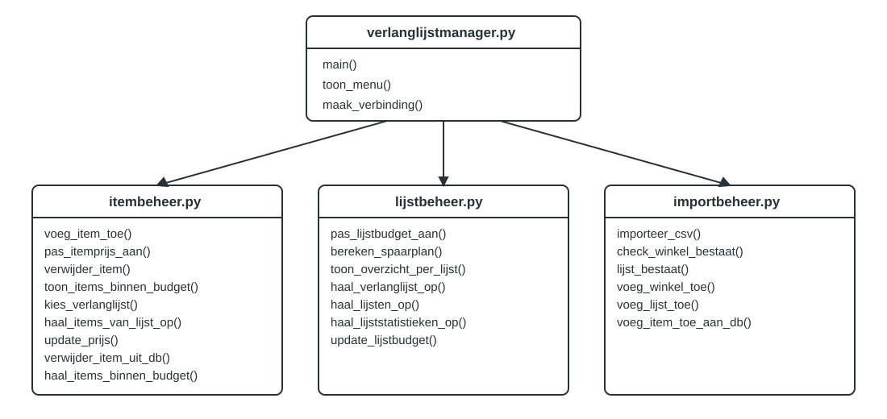

# Ontwerp Verlanglijstmanager

## Inleiding

Dit document beschrijft het ontwerp van Verlanglijstmanager. Dit ontwerp biedt de technische basis voor de realisatie van de applicatie.

## Technische eisen

### TE1. Data-integriteit
De applicatie maakt gebruik van een SQLite-database. Tabellen worden voorzien van primaire sleutels en waar nodig vreemde sleutels om relaties tussen verlanglijsten, winkels en items af te dwingen. Budgetwaarden worden opgeslagen als numerieke datatypes en invoer wordt gevalideerd voordat deze wordt opgeslagen.

### TE2. Toegangsbeveiliging
Bij het opstarten van de applicatie moet de gebruiker een toegangscode invoeren. Alleen na succesvolle verificatie wordt toegang verleend tot de functionaliteiten van de applicatie.

### TE3. Bescherming van gevoelige configuratie
Gevoelige configuratiegegevens worden opgeslagen in een `.env`-bestand. Dit bestand wordt opgenomen in `.gitignore`, zodat het niet in versiebeheer terechtkomt. De applicatie leest deze waarden in via omgevingsvariabelen.

### TE4. Veilige opslag van toegangscode
De toegangscode wordt niet in platte tekst opgeslagen. Voor opslag en verificatie wordt een cryptografische hashfunctie gebruikt.

### TE5. Gebruikersinterface
De applicatie biedt een command-line interface (CLI) met duidelijke menuopties, invoerprompts en foutmeldingen. De gebruiker moet verlanglijsten en items kunnen beheren zonder kennis van de interne datastructuur.

### TE6. Uitbreidbaarheid
De software wordt modulair opgebouwd met een scheiding tussen gebruikersinterface, bedrijfslogica en datalaag. Nieuwe functionaliteiten moeten kunnen worden toegevoegd zonder grote wijzigingen aan bestaande componenten.

### TE7. Budgetcontrole en haalbaarheidsanalyse
De applicatie berekent automatisch de totale kosten van een verlanglijst op basis van de gekoppelde items en verzendkosten. Het beschikbare budget wordt vergeleken met de berekende kosten en er wordt direct een melding gegeven wanneer het budget wordt overschreden.

### TE8. Uitvoerbaarheid
De applicatie wordt ontwikkeld in Python 3 en kan vanaf een standaard Linux-omgeving worden gestart via een terminalcommando. Externe afhankelijkheden worden vastgelegd in een `requirements.txt`-bestand.

### TE9. Gegevensportabiliteit
Bestandslocaties worden niet hardcoded in de broncode. De applicatie werkt met configureerbare bestandspaden en moet gegevens kunnen lezen en schrijven op verschillende opslaglocaties.

## Tabelontwerp

Het domeinmodel wordt vertaald naar de tabellen `Winkel`, `Lijst` en `Item` volgens `db/creates.sql`.

### Winkel

| Kolom | Datatype | Sleutel | Verplicht | Standaardwaarde |
|---|---|---|---|---|
| naam | VARCHAR | PK | Ja | - |
| verzendkosten | REAL | | Nee | - |

### Lijst

| Kolom | Datatype | Sleutel | Verplicht | Standaardwaarde |
|---|---|---|---|---|
| naam | VARCHAR | PK | Ja | - |
| budget_limiet | REAL | | Nee | - |

### Item

| Kolom | Datatype | Sleutel | Verplicht | Standaardwaarde |
|---|---|---|---|---|
| titel | VARCHAR | PK | Ja | - |
| prijs | REAL | | Ja | - |
| prioriteit | INTEGER | | Nee | - |
| lijst | VARCHAR | PK, FK naar Lijst.naam | Ja | - |
| winkel | VARCHAR | FK naar Winkel.naam | Nee | - |

## Afhankelijkheden

De applicatie "Verlanglijstmanager" is afhankelijk van de volgende bibliotheken:

- `sqlite3` - Voor het opslaan en ophalen van gegevens in de SQLite-database.
- `csv` - Voor het importeren van items uit CSV-bestanden.
- `hashlib` - Voor het hashen van de toegangscode.

## Detailontwerp

De applicatie "Verlanglijstmanager" bestaat uit de onderstaande elementen.

### Globale variabelen

- `DATABASE` in `verlanglijstmanager.py`: Pad naar het SQLite-databasebestand.
- `sessiestatistieken` in `itembeheer.py`: Teller met aantallen toegevoegde en verwijderde items tijdens de huidige sessie.
- `STANDAARD_VERZENDKOSTEN` in `importbeheer.py`: Standaardwaarde voor verzendkosten bij nieuw aangemaakte winkels via CSV-import.
- `STANDAARD_LIJSTBUDGET` in `importbeheer.py`: Standaardbudget voor nieuw aangemaakte lijsten via CSV-import.

### Software-architectuur

### Functies module "verlanglijstmanager.py"

- `maak_verbinding()`: Maakt een SQLite-verbinding met `db/verlanglijstmanager.db`, activeert foreign keys en retourneert de verbinding.
- `toon_menu()`: Toont het hoofdmenu en vraagt de gebruiker om een keuze.
- `main()`: Start de applicatie, controleert toegangscode, maakt de databaseverbinding en stuurt de menu-acties aan.
- `controleer_toegangscode()`: Controleert of de ingevoerde toegangscode overeenkomt met de hash uit `.env`.
- `lees_toegangscode_hash()`: Leest de hash van de toegangscode uit het `.env`-bestand.

### Functies module "itembeheer.py"

- `voeg_item_toe(verbinding)`: Registreert handmatig een nieuw item en verhoogt de sessieteller.
- `pas_itemprijs_aan(verbinding)`: Past de prijs van een geselecteerd item aan.
- `verwijder_item(verbinding)`: Verwijdert een geselecteerd item en verhoogt de sessieteller.
- `toon_items_binnen_budget(verbinding)`: Toont items tussen twee opgegeven budgetgrenzen.
- `toon_beschikbare_verlanglijsten(verbinding)`: Toont beschikbare lijsten voor gebruikerskeuze.
- `kies_verlanglijst(verbinding)`: Laat de gebruiker een lijst selecteren op nummer.
- `haal_alle_items_op(verbinding)`: Haalt alle items op inclusief winkel- en lijstnaam via een JOIN-operatie.
- `haal_items_van_lijst_op(verbinding, lijstnaam)`: Haalt items op van een specifieke verlanglijst.
- `haal_lijsten_op(verbinding)`: Haalt alle lijsten op inclusief budget.
- `update_prijs(verbinding, lijstnaam, titel, nieuwe_prijs)`: Past de prijs van een item aan in de database.
- `verwijder_item_uit_db(verbinding, lijstnaam, titel)`: Verwijdert een item op basis van lijst en titel.
- `voeg_item_toe_aan_db(verbinding, titel, prijs, winkel_naam, lijst_naam, prio)`: Voegt een item toe aan de tabel `Item`.
- `haal_items_binnen_budget(verbinding, min_budget, max_budget)`: Haalt items op binnen een budgetrange.
- `check_winkel_bestaat(verbinding, winkelnaam)`: Controleert of een winkel bestaat in de database.

### Functies module "lijstbeheer.py"

- `pas_lijstbudget_aan(verbinding)`: Vraagt een nieuw budget voor een gekozen lijst en slaat dit op.
- `bereken_spaarplan(verbinding)`: Toont een persoonlijk spaarplan op basis van itemprijs en maanden.
- `toon_overzicht_per_lijst(verbinding)`: Toont statistieken en budgetcontrole per lijst.
- `haal_verlanglijst_op(verbinding)`: Haalt items op inclusief winkel- en lijstnaam.
- `haal_lijsten_op(verbinding)`: Haalt alle lijsten op met budget.
- `haal_lijststatistieken_op(verbinding)`: Haalt de statistieken per lijst op uit de database.
- `update_lijstbudget(verbinding, lijstnaam, nieuw_budget)`: Werkt het budget van een lijst bij.

### Functies module "importbeheer.py"

- `importeer_csv(verbinding)`: Importeert items uit een CSV-bestand en maakt ontbrekende winkels en lijsten aan.
- `check_winkel_bestaat(verbinding, winkelnaam)`: Controleert of een winkel bestaat.
- `lijst_bestaat(verbinding, lijstnaam)`: Controleert of een lijst bestaat.
- `voeg_winkel_toe(verbinding, winkelnaam, verzendkosten)`: Voegt een nieuwe winkel toe aan de database.
- `voeg_lijst_toe(verbinding, lijstnaam, budget_limiet)`: Voegt een nieuwe lijst toe aan de database.
- `voeg_item_toe_aan_db(verbinding, titel, prijs, winkel_naam, lijst_naam, prio)`: Voegt een item toe aan de database.