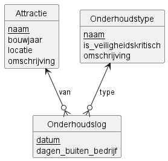

# Analyse Oosteling

## Inleiding

In dit document worden de functionele en niet-functionele eisen voor het digitale onderhoudsbeheersysteem van attractiepark *De Oosteling* geanalyseerd. De analyse is gebaseerd op een interview met Adinda van d’Ort, het hoofd onderhoud van het park, en de huidige onderhoudsprocessen.

### User stories

**US1.** [Must] Als onderhoudsmedewerker wil ik gegevens van attracties en onderhoudstypes eenvoudig kunnen inladen, zodat ik vooraf gemaakte overzichten kan gebruiken.

**US2.** [Must] Als onderhoudsmedewerker wil ik een nieuwe attractie handmatig kunnen toevoegen, zodat het systeem actueel blijft als er een nieuwe attractie in het park komt.

**US3.** [Must] Als onderhoudsmedewerker wil ik een nieuw onderhoudstype handmatig kunnen toevoegen, zodat het systeem actueel blijft als er samen met de directeur een nieuw type is vastgesteld.

**US4.** [Must] Als onderhoudsmedewerker wil ik een uitgevoerd onderhoud kunnen registreren met daarbij de attractie, het onderhoudstype, de datum en het aantal dagen dat de attractie buiten bedrijf is geweest, zodat de traceability van het onderhoud geborgd is.

**US5.** [Must] Als onderhoudsmedewerker wil ik een overzicht kunnen opvragen van alle attracties die in het systeem staan, zodat ik kan controleren of de lijst compleet en correct is.

**US6.** [Must] Als onderhoudsmedewerker wil ik een overzicht kunnen opvragen van alle onderhoudstypes die in het systeem staan, zodat de directeur aan externe toezichthouders kan laten zien dat de lijst compleet is.

**US7.** [Must] Als onderhoudsmedewerker wil ik een overzicht kunnen opvragen van alle uitgevoerde onderhoudsregistraties met daarbij de attractie, het onderhoudstype, de datum en het aantal dagen buiten bedrijf, zodat ik inzicht heb in de uitgevoerde onderhoudshistorie.

**US8.** [Must] Als onderhoudsmedewerker wil ik een staafdiagram kunnen bekijken met het aantal uitgevoerde onderhoudsregistraties per attractie, zodat ik in één oogopslag zie welke attracties de meeste onderhoudsbeurten hebben gehad.

**US9.** [Must] Als onderhoudsmedewerker wil ik een taartdiagram kunnen bekijken met het aantal uitgevoerde onderhoudsregistraties per onderhoudstype, zodat ik inzicht krijg in de verdeling van de typen onderhoud.

**US10.** [Should] Als onderhoudsmedewerker wil ik bij het starten van de applicatie een wachtwoord moeten invoeren, zodat niet iedereen zomaar toegang heeft tot de applicatie.

**US11.** [Could] Als onderhoudsmedewerker wil ik attracties kunnen laten indelen in categorieen op basis van het totaal aantal dagen buiten bedrijf, zodat ik snel zie welke attracties de meeste stilstand hebben.

### User concerns

**C1. Data integrity:** Het systeem moet ervoor zorgen dat de gegevens van attracties en onderhoudstypes correct en volledig zijn, zodat de traceability van het onderhoud gewaarborgd is.

**C2. Security:** De applicatie moet beschermd worden tegen ongeautoriseerde toegang door het gebruik van een toegangscode.

**C3. Security:** Gevoelige configuratie, zoals de toegangscode, mag niet hardcoded in de broncode staan.

**C4. Security:** De toegangscode moet op een veilige manier worden opgeslagen.

**C5. Data portability:** De applicatie moet eenvoudig data uit bestaande bestanden kunnen importeren.

## Use cases

### UC1: Attracties importeren uit CSV-bestand
**Actor:** Onderhoudsmedewerker  
**Preconditie:** Het bestand `data/attracties.csv` is aanwezig en bevat de kolommen `naam`, `bouwjaar`, `locatie` en `omschrijving`.  
**Beschrijving:**

1. De onderhoudsmedewerker selecteert de menuoptie om attracties te importeren.
2. De applicatie opent `data/attracties.csv`.
3. De applicatie leest het bestand regel voor regel.
4. Per rij voegt de applicatie de attractie toe aan de database met naam, bouwjaar, locatie en omschrijving.

### UC2: Onderhoudstypes importeren uit CSV-bestand
**Actor:** Onderhoudsmedewerker  
**Preconditie:** Het bestand `data/onderhoudstypes.csv` is aanwezig en bevat de kolommen `naam`, `is_veiligheidskritisch` en `omschrijving`.  
**Beschrijving:**

1. De onderhoudsmedewerker selecteert de menuoptie om onderhoudstypes te importeren.
2. De applicatie opent `data/onderhoudstypes.csv`.
3. De applicatie leest het bestand regel voor regel.
4. Per rij voegt de applicatie het onderhoudstype toe aan de database met naam, veiligheidskritisch-vlag en omschrijving.

### UC3: Nieuwe attractie toevoegen
**Actor:** Onderhoudsmedewerker  
**Preconditie:** Geen.  
**Beschrijving:**

1. De onderhoudsmedewerker selecteert de menuoptie om een attractie toe te voegen.
2. De onderhoudsmedewerker voert de naam van de attractie in.
3. De onderhoudsmedewerker voert het bouwjaar in.
4. De applicatie controleert of het bouwjaar een geldig geheel getal is.
5. De onderhoudsmedewerker voert de locatie in.
6. De onderhoudsmedewerker voert een korte omschrijving in.
7. De applicatie voegt de attractie toe aan de database.

**Alternatieve flow:**
- Stap 4: Bouwjaar is geen geldig geheel getal → Applicatie geeft een foutmelding en stopt de invoer.

### UC4: Nieuw onderhoudstype toevoegen
**Actor:** Onderhoudsmedewerker  
**Preconditie:** Geen.  
**Beschrijving:**

1. De onderhoudsmedewerker selecteert de menuoptie om een onderhoudstype toe te voegen.
2. De onderhoudsmedewerker voert de naam van het onderhoudstype in.
3. De onderhoudsmedewerker geeft aan of het onderhoudstype veiligheidskritisch is (ja/nee).
4. De onderhoudsmedewerker voert een korte omschrijving in.
5. De applicatie voegt het onderhoudstype toe aan de database.

### UC5: Uitgevoerd onderhoud registreren
**Actor:** Onderhoudsmedewerker  
**Preconditie:** De betreffende attractie en het betreffende onderhoudstype bestaan in de database.  
**Beschrijving:**

1. De onderhoudsmedewerker selecteert de menuoptie om uitgevoerd onderhoud te registreren.
2. De onderhoudsmedewerker voert de naam van de attractie in.
3. De applicatie controleert of de attractie bestaat in de database.
4. De onderhoudsmedewerker voert de naam van het onderhoudstype in.
5. De applicatie controleert of het onderhoudstype bestaat in de database.
6. De onderhoudsmedewerker voert de datum van het onderhoud in (formaat YYYY-MM-DD).
7. De onderhoudsmedewerker voert het aantal dagen dat de attractie buiten bedrijf is geweest in.
8. De applicatie slaat de onderhoudsregistratie op in de database.

**Alternatieve flows:**
- Stap 3: Attractie bestaat niet → Applicatie geeft een foutmelding en stopt de invoer.
- Stap 5: Onderhoudstype bestaat niet → Applicatie geeft een foutmelding en stopt de invoer.

### UC6: Overzicht van alle attracties weergeven
**Actor:** Onderhoudsmedewerker  
**Preconditie:** Geen.  
**Beschrijving:**

1. De onderhoudsmedewerker selecteert de menuoptie om alle attracties te tonen.
2. De applicatie haalt alle attracties op uit de database.
3. Per attractie toont de applicatie de naam, het bouwjaar, de locatie en de omschrijving.

### UC7: Overzicht van alle onderhoudstypes weergeven
**Actor:** Onderhoudsmedewerker  
**Preconditie:** Geen.  
**Beschrijving:**

1. De onderhoudsmedewerker selecteert de menuoptie om alle onderhoudstypes te tonen.
2. De applicatie haalt alle onderhoudstypes op uit de database.
3. Per onderhoudstype toont de applicatie de naam, of het veiligheidskritisch is en de omschrijving.

### UC8: Overzicht van alle onderhoudsregistraties weergeven
**Actor:** Onderhoudsmedewerker  
**Preconditie:** Geen.  
**Beschrijving:**

1. De onderhoudsmedewerker selecteert de menuoptie om alle onderhoudsregistraties te tonen.
2. De applicatie haalt alle onderhoudsregistraties op uit de database.
3. Per registratie toont de applicatie de attractienaam, het onderhoudstype, de datum en het aantal dagen buiten bedrijf.

### UC9: Staafdiagram per attractie weergeven
**Actor:** Onderhoudsmedewerker  
**Preconditie:** Geen.  
**Beschrijving:**

1. De onderhoudsmedewerker selecteert de menuoptie om het staafdiagram per attractie te tonen.
2. De applicatie vraagt of de weergave een grafische afbeelding (1) of ASCII-art (2) moet zijn.
3. De applicatie haalt het aantal onderhoudsregistraties per attractie op uit de database.
4. De applicatie toont het staafdiagram.

**Alternatieve flow:**
- Stap 2: Keuze ASCII-art → De onderhoudsmedewerker voert de maximale balklengte in. De applicatie controleert of dit een geheel getal groter dan 0 is. De onderhoudsmedewerker voert het tekenkarakter voor de balken in. De applicatie toont het staafdiagram als ASCII-art.
- Stap 2 (ASCII), maximale balklengte ongeldig (geen geheel getal of ≤ 0) → Applicatie geeft een foutmelding en stopt de weergave.

### UC10: Taartdiagram per onderhoudstype weergeven
**Actor:** Onderhoudsmedewerker  
**Preconditie:** Geen.  
**Beschrijving:**

1. De onderhoudsmedewerker selecteert de menuoptie om het taartdiagram per onderhoudstype te tonen.
2. De applicatie haalt het aantal onderhoudsregistraties per onderhoudstype op uit de database.
3. De applicatie toont een taartdiagram met de verdeling over de onderhoudstypes.

### UC11: Toegangscontrole bij opstarten
**Actor:** Onderhoudsmedewerker  
**Preconditie:** Het bestand `.env` is aanwezig en bevat een `TOEGANGSCODE_HASH`.  
**Beschrijving:**

1. De applicatie start op en vraagt de onderhoudsmedewerker om een toegangscode.
2. De applicatie berekent de SHA-256 hash van de ingevoerde code.
3. De applicatie leest de opgeslagen hash op uit het `.env`-bestand.
4. De applicatie vergelijkt de berekende hash met de opgeslagen hash.
5. Bij een overeenkomst wordt de applicatie verder gestart.

**Alternatieve flows:**
- Stap 3: `TOEGANGSCODE_HASH` ontbreekt in `.env` → Applicatie geeft een foutmelding en sluit af.
- Stap 4: Hashes komen niet overeen → Applicatie geeft een foutmelding en sluit af.

### UC12: Overzicht attracties per categorie buiten bedrijf dagen
**Actor:** Onderhoudsmedewerker  
**Preconditie:** Er staan attracties in de database.  
**Beschrijving:**

1. De onderhoudsmedewerker selecteert de menuoptie voor het overzicht op basis van dagen buiten bedrijf.
2. De onderhoudsmedewerker voert het gewenste aantal categorieen in.
3. De applicatie controleert of het aantal categorieen een geheel getal groter dan 0 is.
4. De applicatie haalt per attractie het totaal aantal dagen buiten bedrijf op, aflopend gesorteerd.
5. De applicatie bepaalt de categoriebreedte op basis van de attractie met de hoogste stilstand.
6. De applicatie deelt attracties in categorieen in volgens de berekende grenzen.
7. De applicatie toont per categorie de grenswaarden en de attracties met hun totale aantal dagen buiten bedrijf.
8. Als een categorie geen attracties bevat, toont de applicatie expliciet dat de categorie leeg is.

**Alternatieve flow:**
- Stap 3: Ongeldige invoer (geen geheel getal of ≤ 0) → Applicatie geeft een foutmelding en stopt de weergave.

---

## Traceability Matrix

## Domeinmodel

---
