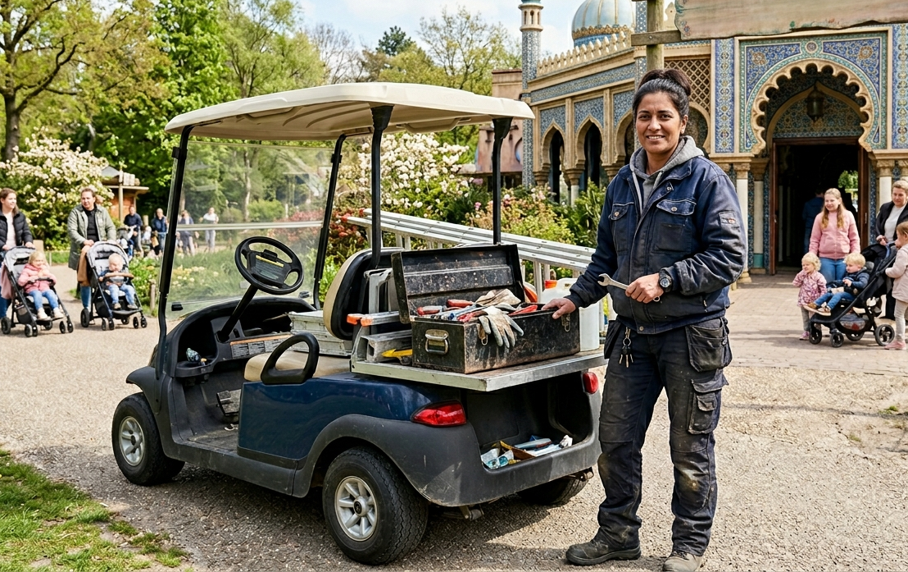

# Interviewverslag: Onderhoudsbeheer in "De Oosteling"
**Datum:** 12 maart 2026  
**Interviewer:** Projectteam ICT
**Geïnterviewde:** Adinda van d’Ort (Hoofd Onderhoud)  
**Onderwerp:** Digitalisering van het onderhoudsproces



---

## Introductie
Adinda van d’Ort is inmiddels ruim tien jaar verantwoordelijk voor het technisch onderhoud van attractiepark *De Oosteling*. Met een achtergrond in de werktuigbouwkunde en een passie voor pretparktechniek zorgt zij ervoor dat alle attracties dagelijks veilig kunnen draaien. In dit gesprek verkennen we haar huidige werkwijze en de functionele eisen voor het nieuwe digitale beheersysteem.

---

## Het Interview

**Interviewer:** Goedemorgen Adinda, fijn dat je tijd voor ons hebt. We willen graag begrijpen hoe jij momenteel het onderhoud van het park beheert en waar een nieuw systeem je zou kunnen ondersteunen.

**Adinda:** Goedemorgen! Ja, kom verder. Koffie? Ik zit hier tussen de bouwtekeningen en het smeervet, zoals je ziet. Ik werk hier nu al ruim tien jaar met veel plezier. Het is een prachtig vak; de ene dag sta ik bovenin de *Rockbird* om een sensor te checken terwijl de wind om mijn oren waait, en de andere dag ben ik beneden bij de *Spiegel van Faye* bezig met de verlichting. 

Het contact met de bezoekers is ook goud waard. Als ik een kind zie lachen in de *Nachtvlucht*, dan weet ik weer precies waar ik het voor doe: veiligheid en plezier. Maar goed, jullie komen voor de techniek achter de schermen, hè?

**Interviewer:** Precies. Kun je ons meenemen in je dagelijkse routine?

**Adinda:** Nou, mijn dag begint altijd met een ronde door het park. Ik heb mijn trouwe aantekeningenboekje altijd bij me. Terwijl ik loop, let ik op alles. Hoor ik een vreemd tikje bij de *Kompelklap*? Dan schrijf ik dat op. Zie ik dat de verf bij de *Confetticocktail* begint te bladderen? Hup, in het boekje. Ik noteer wat ik zie, bij welke attractie het is en de datum. Eigenlijk heb ik dat boekje altijd in mijn zak, ook als ik even naar de kantine loop voor een pauze.

**Interviewer:** En wat gebeurt er met die aantekeningen?

**Adinda:** Nou, een deel daarvan bewaar ik gewoon om een beetje bij te houden wat ik gezien heb, maar een deel wordt natuurlijk meteen omgezet in actie: dan wordt er onderhoud gepleegd. En daar loopt het nu helaas mis, want ik voldoe niet aan de eisen die de Jurgen Fonssen, de directeur, stelt.

**Interviewer:** Wat bedoel je daarmee?

**Adinda:** Nou, het onderhoud zelf is het probleem niet hoor, ik ben tenslotte goed opgeleid en zeer ervaren, en huur altijd de juiste extra ondersteuning in. Je hoeft je dus geen zorgen te maken dat het onderhoud zelf niet in orde is. Het gaat om de traceability. Jurgen wil dat er goed wordt bijgehouden welk onderhoud is gepleegd en wanneer dit was. Ze willen ook dat ik elke onderhoudsklus koppel aan een bepaald onderhoudstype. Dat hebben zij weer nodig om verantwoording af te leggen.

**Interviewer:** Je zoekt dus een systeem om het uitgevoerde onderhoud gestructureerd vast te leggen? Welke informatie wil je dan vastleggen?

**Adinda:** Klopt, je slaat de spijker op z'n kop, misschien kun jij ook wel in 't onderhoud gaan werken, haha. Nee, serieus, ik moet inderdaad nauwkeurig gaan bijhouden welk onderhoud er is uitgevoerd. Jurgen heeft daarvoor samen met mij een lijst onderhoudstypes vastgelegd. En van elk onderhoudstype is ook vastgelegd of het om een veiligheidskritisch onderhoud gaat of niet. Die lijsten moet Jurgen kunnen laten zien aan externe toezichthouders.

**Interviewer:** Dat klinkt logisch. En wat staat moet er dan nog meer in het systeem komen?

**Adinda:** Dat is eigenlijk heel simpel. We leggen ook een lijst vast met alle attracties die er zijn met daarbij ook het bouwjaar, eventueel de locatie en altijd een korte beschrijving, zodat de rapportages heel duidelijk zijn. En ik moet dan dus voor elke onderhoud dat wordt uitgevoerd vastleggen bij welke attractie dat was en welk onderhoudstype het was. En natuurlijk de datum waarop het onderhoud is uitgevoerd.

**Interviewer:** Oke, en de lijsten met attracties en onderhoudstypes, moet die nog kunnen worden bijgewerkt?

**Adinda:** Ik lever in eerste instantie lijsten aan die de huidige situatie beschrijven. Het systeem moet die lijsten kunnen inlezen, en daarna wil ik nog wel de optie hebben om ze uit te breiden. Als er een nieuwe attractie bijkomt, of ik definieer samen met Jurgen een nieuw onderhoudstype, dan moet die natuurlijk ook in het systeem kunnen worden toegevoegd.

**Interviewer:** En verwijderen?

**Adinda:** Nee, onderhoudstypes mogen nooit verwijderd worden. Die zijn vastgesteld met Jurgen, de directeur, en hebben dus een serieuze status. En attracties? Die gaan er natuurlijk af en toe wel uit, maar laat dat voorlopig maar zitten, want ook van oude attracties moeten we de historie kunnen inzien.

**Interviewer:** Mooi, dat is dan duidelijk. Hebben we nu alles wat vastgelegd moet worden?

**Adinda:** Nee, er is nog iets, Jurgen wil dat ik ook bijhoud hoe lang een attractie buiten bedrijf is geweest bij het uitvoeren van een bepaald onderhoud, dus dat moet ook worden vastgelegd. En dan moeten we het natuurlijk nog hebben over de rapportages.

**Interviewer:** Ja, dat is een belangrijk punt. We leggen nu dus informatie vast over attracties, over onderhoudstypes, en per uitgevoerd onderhoud koppelen we de attractie aan een onderhoudstype met daarbij de datum en duur van het onderhoud. Welke rapportages wil je dan kunnen genereren?

**Adinda:** Nou, de meest voor de hand liggende is natuurlijk een overzicht met daarin al het onderhoud dat is uitgevoerd per attractie en de gegevens daarvan. En daarnaast wil ik graag een grafiek kunnen zien met hoe vaak er onderhoud is gepleegd aan een bepaalde attractie, met iets van een staafdiagram of zo. En een taartdiagram met hoe vaak elk onderhoudstype is uitgevoerd. En natuurlijk wil ik ook kunnen bekijken welke attracties er in het systeem staan en elke onderhoudstypes, zodat ik kan laten zien dat alles compleet is.

**Interviewer:** Dat klinkt als een goed overzicht. Zijn er verder nog wensen of eisen die je hebt voor het systeem?

**Adinda:** Nou, het is de bedoeling dat de applicatie gewoon gaat draaien op mijn eenvoudige laptopje, dus iets van een koppeling met de cloud of zo is niet nodig. Wel is het fijn als je iets van een basale beveiliging kunt toevoegen zodat niet iedereen zomaar in de applicatie kan als ik m'n laptop weer 'ns vergeet te locken. Tsja, met de attracties ben ik superzorgvuldig, maar met m'n laptop ben ik soms wat slordig, haha. Gewoon dat me om een wachtwoord wordt gevraagd bij het opstarten van de applicatie is genoeg.

**Interviewer:** Nog iets anders?

**Adinda:** Nou, ik heb het er met Jurgen wel 'ns over gehad dat we eigenlijk wel 'n overzicht zouden willen hebben van attracties die veel dagen buiten bedrijf zijn geweest. Ik zie een overzicht voor me waarin de attracties worden gesorteerd op het totaal aantal dagen dat ze buiten bedrijf zijn geweest en dan in categorieën worden opgedeeld. Het aantal categorieën moet ik kunnen invoeren, en dan wordt de lijst met attracties in die categorieën verdeeld.

**Interviewer:** Dat klinkt als een mooie extra functionaliteit, maar hoe zie je dat dan precies voor je? Hoe gaat die indeling? Kun je misschien een voorbeeld geven?

**Adinda:** Zeker, stel dat ik kies voor 3 categorieën en de attractie die het langst buiten bedrijf is geweest heeft 30 dagen. Dan komen in de eerste categorie attracties die 1 tot 10 dagen buiten bedrijf zijn geweest, in de tweede categorie attracties die 11 tot 20 dagen buiten bedrijf zijn geweest, en in de derde categorie attracties die 21 tot 30 dagen buiten bedrijf zijn geweest. En het kan dan dus best zo zijn dat zo'n categorie leeg is. En attracties die helemaal geen onderhoud hebben gehad hoeven niet in de lijst. Wacht, ik schets het even voor je:

```text

Categorie 1: 1-10 dagen
- Attractie A: 5 dagen
- Attractie B: 8 dagen
Categorie 2: 11-20 dagen
- Geen attracties
Categorie 3: 21-30 dagen
- Attractie C: 30 dagen
```

En natuurlijk moet de applicatie dan zelf uitrekenen wat de grenswaarden van de categorieën zijn, want ik wil alleen het aantal categorieën moeten invoeren.

**Interviewer:** Hmmm, ik denk dat ik het begrijp. Dit is wel een ingewikkelde functie, maar dat gaat wel lukken. Dan nog een technisch vraagje. Vinden er wel een eens meerdere types onderhoud plaats op dezelfde dag bij dezelfde attractie?

**Adinda:** Ja, dat kan zeker voorkomen. Soms doe ik bijvoorbeeld twee kleine onderhoudsklusjes tegelijk bij een attractie, en dan wil ik die dus ook apart kunnen vastleggen. Het is dus belangrijk dat het systeem meerdere onderhoudsregistraties per attractie per dag kan bijhouden. Maar ik er zijn nooit meerdere van dezelfde onderhoudstype op dezelfde dag bij dezelfde attractie.

**Interviewer:** De combinatie van attractie, onderhoudstype en datum is dus altijd uniek?

**Adinda:** Ja, dat klopt.

**Interviewer:** Oké, dat is duidelijk. Ik ga ermee aan de slag!