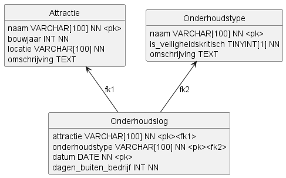

# Ontwerp Oosteling

## Inleiding

Dit document beschrijft het ontwerp van de applicatie Oosteling. Dit ontwerp biedt de technische basis voor de realisatie van de onderhoudsbeheerapplicatie voor attractiepark De Oosteling.

## Database-ontwerp

## Afhankelijkheden

De applicatie Oosteling is afhankelijk van de volgende bibliotheken:

- sqlite3 - Voor het opslaan en ophalen van gegevens in de SQLite-database.
- csv - Voor het inlezen van brondata uit CSV-bestanden.
- hashlib - Voor het hashen en controleren van de toegangscode.
- matplotlib - Voor het tekenen van grafieken (staafdiagram en taartdiagram).

## Software-architectuur

## Detailontwerp

De applicatie Oosteling bestaat uit de onderstaande elementen.

### Globale variabelen module Oosteling

Geen globale variabelen gedefinieerd in deze module.

### Functies module Oosteling

- maak_verbinding(): Maakt een verbinding met de database.
- toon_menu(): Toont het hoofdmenu en vraagt de gebruiker om een keuze te maken.
- main(): Hoofdfunctie die de verbinding met de database maakt en het hoofdmenu toont totdat de gebruiker ervoor kiest om af te sluiten.

### Globale variabelen module Attractie

- attracties_csv: Pad naar het CSV-bestand met attractiegegevens (data/attracties.csv).

### Functies module Attractie

- importeer_attracties_uit_csv(verbinding): Importeert attracties uit een CSV-bestand en voegt ze toe aan de database.
- voeg_attractie_toe(verbinding): Voegt een nieuwe attractie toe aan de database.
- voeg_attractie_toe_aan_database(verbinding, naam, bouwjaar, locatie, omschrijving): Voegt een nieuwe attractie toe aan de database.
- attractie_bestaat(verbinding, naam): Controleert of een attractie met de gegeven naam bestaat in de database.
- toon_attracties(verbinding): Toont alle attracties uit de database.
- haal_attracties_op_uit_database(verbinding): Haalt alle attracties op uit de database.

### Globale variabelen module Onderhoudstype

- onderhoudstypes_csv: Pad naar het CSV-bestand met onderhoudstypegegevens (data/onderhoudstypes.csv).

### Functies module Onderhoudstype

- importeer_onderhoudstypes_uit_csv(verbinding): Importeert onderhoudstypes uit een CSV-bestand en voegt ze toe aan de database.
- voeg_onderhoudstype_toe(verbinding): Voegt een nieuw onderhoudstype toe aan de database.
- voeg_onderhoudstype_toe_aan_database(verbinding, naam, veiligheidskritisch, omschrijving): Voegt een nieuw onderhoudstype toe aan de database.
- toon_onderhoudstypes(verbinding): Toont alle onderhoudstypes in de database.
- haal_onderhoudstypes_op_uit_database(verbinding): Haalt alle onderhoudstypes op uit de database.
- onderhoudstype_bestaat(verbinding, onderhoudstype): Controleert of een onderhoudstype met de gegeven naam bestaat in de database.

### Globale variabelen module Onderhoudslog

Geen globale variabelen gedefinieerd in deze module.

### Functies module Onderhoudslog

- registreer_uitgevoerd_onderhoud(verbinding): Registreert een uitgevoerd onderhoud in de database.
- registreer_uitgevoerd_onderhoud_in_database(verbinding, attractienaam, onderhoudstype, datum, dagen_buiten_bedrijf): Registreert een uitgevoerd onderhoud in de database.
- toon_uitgevoerde_onderhoudsregistraties(verbinding): Toont alle uitgevoerde onderhoudsregistraties in de database.
- haal_uitgevoerde_onderhoudsregistraties_op_uit_database(verbinding): Haalt alle uitgevoerde onderhoudsregistraties op uit de database.
- toon_aantal_uitgevoerde_onderhoudsregistraties_per_attractie(verbinding): Interactieve functie om een grafiek te tonen met het aantal uitgevoerde onderhoudsregistraties per attractie.
- toon_grafiek_van_aantal_uitgevoerde_onderhoudsregistraties_per_attractie_als_afbeelding(verbinding): Functie om aantal uitgevoerde onderhoudsregistraties per attractie uit database te halen en als staafdiagram te tonen.
- toon_grafiek_van_aantal_uitgevoerde_onderhoudsregistraties_per_attractie_als_ascii(verbinding, maximum_staaflengte, karakter): Functie om aantal uitgevoerde onderhoudsregistraties per attractie uit database te halen en als ASCII-art te tonen.
- haal_aantal_uitgevoerde_onderhoudsregistraties_per_attractie_op_uit_database(verbinding): Functie om aantal uitgevoerde onderhoudsregistraties per attractie uit database te halen.
- toon_aantal_uitgevoerde_onderhoudsregistraties_per_onderhoudstype(verbinding): Functie om het aantal uitgevoerde onderhoudsregistraties per onderhoudstype uit database te halen en als taartdiagram te tonen.
- toon_overzicht_attracties_op_basis_van_buiten_bedrijf_dagen(verbinding): Toont attracties op basis van totale dagen buiten bedrijf, verdeeld in categorieen.
- haal_totaal_dagen_buiten_bedrijf_per_attractie_op_uit_database(verbinding): Haalt per attractie met geregistreerd onderhoud het totaal aantal dagen buiten bedrijf op, oplopend gesorteerd.
- haal_aantal_uitgevoerde_onderhoudsregistraties_per_onderhoudstype_op_uit_database(verbinding): Functie om aantal uitgevoerde onderhoudsregistraties per onderhoudstype uit database te halen.

### Globale variabelen module Beveiliging

Geen globale variabelen gedefinieerd in deze module.

### Functies module Beveiliging

- lees_toegangscode_hash(): Leest de hash van de toegangscode uit het .env-bestand.
- controleer_toegangscode(): Controleert of de ingevoerde toegangscode klopt.

