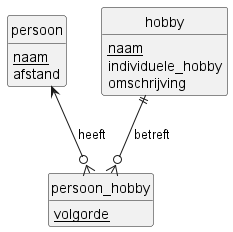
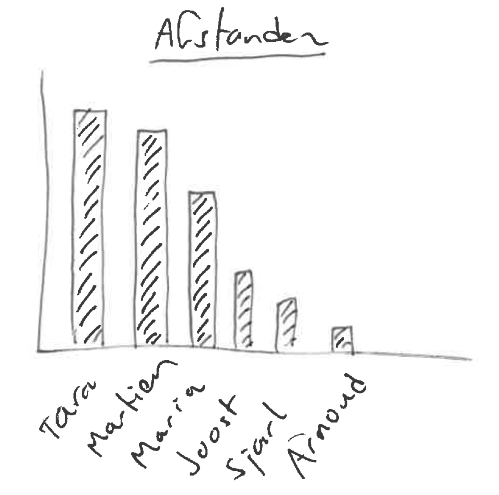
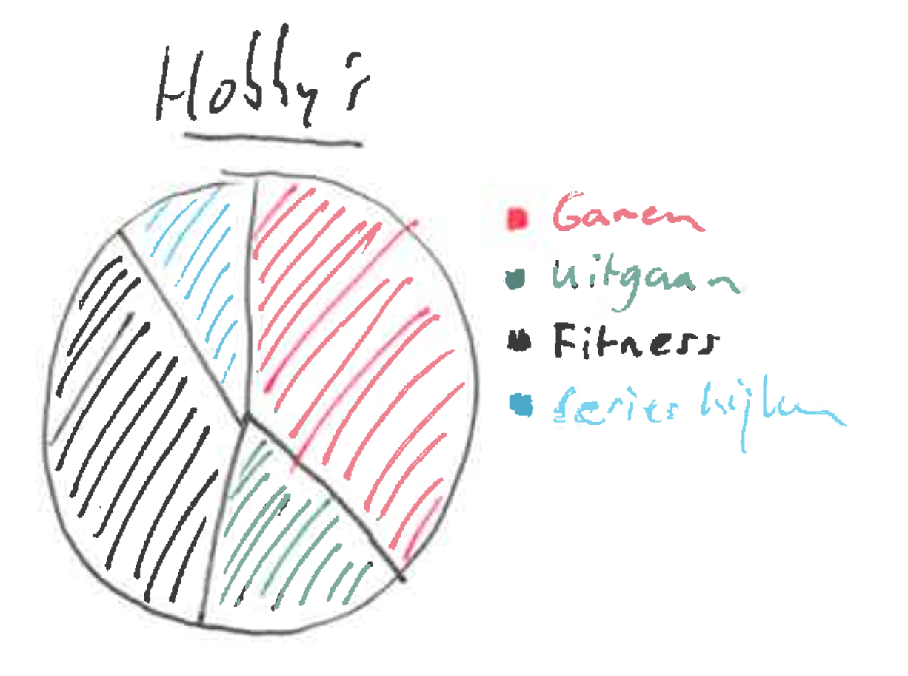

# Analyse Klaskompas

## Inleiding

In dit document worden de functionele en niet-functionele eisen van de applicatie "Klaskompas" beschreven. Deze applicatie is bedoeld voor docenten die hun studenten beter willen leren kennen door hun interesses en achtergrond in kaart te brengen. De focus ligt op het vastleggen van studentgegevens, hobby's en reisafstanden, met ondersteuning voor visualisatie en slimme groepsindelingen.

### User stories

**US1.** [Must] Als docent wil ik een lijst van studenten en de afstand van hun huis tot school importeren zodat ik hierover informatie kan opvragen.

**US2.** [Must] Als docent wil ik een lijst van hobby's kunnen importeren, met daarin de naam van de hobby, een korte omschrijving van de hobby en of het om een individuele of groepshobby gaat, zodat ik studenten aan hobby's kan koppelen.

**US3.** [Should] Als docent wil ik hobby's kunnen toevoegen met daarbij de naam van de hobby, een korte omschrijving en of het om een individuele of groepshobby gaat, zodat ik ook aan hobby's die nog niet in het systeem staan studenten kan koppelen.

**US4.** [Must] Als docent wil ik een student aan een hobby kunnen koppelen, zodat de student en de studenten elkaar kunnen leren kennen.

**US5.** [Must] Als docent wil ik kunnen weergeven hoe ver alle studenten van school wonen, zodat ik kan inschatten wie een lange reistijd heeft.

**US6.** [Must] Als docent wil ik de afstand behorende bij een student kunnen bijwerken zodat ik een verhuizing kan verwerken.

**US7.** [Could] Als docent wil ik voor een student een hobby kunnen verwijderen zodat ik de lijst actueel kan houden.

**US8.** [Should] Als docent wil ik de hobby's van alle studenten kunnen afdrukken, zodat gemakkelijk te zien is wie dezelfde hobby heeft.

**US9.** [Should] Als docent wil ik de opgeslagen gegevens kunnen wissen om te voldoen aan de AVG.

**US10.** [Should] Als docent wil ik de hobby's van alle studenten kunnen afdrukken, zodat ik aansprekende voorbeelden kan gebruiken in mijn lessen.

**US11.** -

**US12.** [Could] Als docent wil ik een taartdiagram tonen zodat ik kan zien welke hobby's populair of juist minder populair zijn.

**US13.** [Won't] Als docent wil ik notities kunnen bijhouden per student, zodat ik belangrijke informatie over hen makkelijk kan terugvinden.

### User concerns

**C1. Persoonlijke benadering:** De docent wil studenten beter kunnen begrijpen en persoonlijker kunnen benaderen op basis van hun interesses en achtergrond.

**C2. Visualisatie:** De applicatie moet inzichten geven in afstanden en populariteit van hobby's door middel van grafieken.

**C3. Data op pc:** De applicatie draait stand-alone op de pc van de docent, dus de gegevens en privacy van studenten zijn onder controle van de docent.

**C4. Fouttoleratie:** Het systeem beschermt de gebruiker tegen invoerfouten door validatie en duidelijke foutmeldingen.

**C5. Privacy en AVG:** De docent moet alle gegevens kunnen wissen om te voldoen aan de AVG-wetgeving.

## Use cases

### UC1: Basisdata importeren uit CSV-bestanden
**Actor:** Docent  
**Preconditie:** De bestanden `data/personen.csv` en `data/hobbys.csv` zijn aanwezig.  
**Beschrijving:**

1. De docent selecteert de menuoptie om de database te vullen met data uit CSV-bestanden.
2. De applicatie leest `data/personen.csv` regel voor regel.
3. Per persoon probeert de applicatie de afstand als getal te verwerken.
4. Als de afstand ongeldig is, slaat de applicatie die persoon over met een foutmelding.
5. Als de persoon al bestaat, wordt deze niet opnieuw toegevoegd.
6. De applicatie leest vervolgens `data/hobbys.csv` en voegt de hobbyrecords toe aan de database.

### UC2: Hobbygegevens uit CSV verwerken
**Actor:** Docent  
**Preconditie:** Bestand `data/hobbys.csv` is aanwezig en bevat de kolommen naam, individuele_hobby en omschrijving.  
**Beschrijving:**

1. Deze use case wordt uitgevoerd als onderdeel van de gecombineerde importactie.
2. De applicatie opent `data/hobbys.csv`.
3. De applicatie leest de hobbygegevens regel voor regel.
4. Elke regel wordt direct toegevoegd aan de hobbytabel.

### UC3: Hobbygegevens toevoegen
**Actor:** Docent  
**Preconditie:** Geen.  
**Beschrijving:**

1. De docent selecteert de optie om een hobby toe te voegen.
2. De docent voert de naam van de hobby in.
3. De docent voert in of de hobby individueel is of een groepshobby.
4. De docent voert een omschrijving in voor de hobby.
5. De applicatie voegt de hobby toe aan de database.

### UC4: Bijwerken afstand van student
**Actor:** Docent  
**Preconditie:** Geen.  
**Beschrijving:**

1. De docent selecteert de optie om de afstand van een student bij te werken.
2. De docent voert de naam van de student in.
3. De docent voert de nieuwe afstand in.
4. De applicatie controleert of de afstand als getal kan worden verwerkt.
5. Bij geldige invoer wordt een update uitgevoerd op de database.

**Alternatieve flows:**
- Stap 4: Afstand is ongeldig → Applicatie geeft een foutmelding.

### UC5: Student aan hobby koppelen
**Actor:** Docent  
**Preconditie:** De student en hobby moeten beide in de database bestaan.  
**Beschrijving:**

1. De docent selecteert de optie om een hobby te koppelen.
2. De docent voert de naam van de student in.
3. De docent voert de naam van de hobby in.
4. De docent voert ook een volgnummer in voor de hobby van deze student.
5. De applicatie controleert of de student bestaat.
6. De applicatie controleert of de hobby bestaat.
7. De applicatie controleert of de combinatie student-hobby nog niet bestaat.
8. De applicatie controleert of het volgnummer nog niet in gebruik is voor deze student.
9. De applicatie slaat de koppeling op in de database.

**Alternatieve flows:**
- Stap 4: Volgnummer is geen geheel getal → Applicatie geeft een foutmelding.
- Stap 5: Student bestaat niet → Applicatie geeft een foutmelding.
- Stap 6: Hobby bestaat niet → Applicatie geeft een foutmelding.
- Stap 7: Combinatie bestaat al → Applicatie geeft een foutmelding.
- Stap 8: Volgnummer bestaat al voor deze student → Applicatie geeft een foutmelding.

### UC6: Student loskoppelen van hobby
**Actor:** Docent  
**Preconditie:** De koppeling tussen student en hobby moet bestaan.  
**Beschrijving:**

1. De docent selecteert de optie om een hobby te ontkoppelen.
2. De docent voert de naam van de student in.
3. De docent voert de naam van de hobby in.
4. De applicatie controleert of de koppeling bestaat.
5. De applicatie verwijdert de koppeling uit de database.

**Alternatieve flow:**
- Stap 4: Koppeling bestaat niet → Applicatie geeft een foutmelding.

### UC7: Weergeven lijst studenten met hobby's
**Actor:** Docent  
**Preconditie:** Er staan studenten met hobby's in de database.  
**Beschrijving:**

1. De docent selecteert de optie om de lijst van studenten met hobby's weer te geven.
2. De applicatie haalt een lijst op met alle studenten en hun hobby's uit de database.
3. De lijst wordt weergegeven op het scherm met studentnaam, afstand, hobby's en hobbytypes.
4. Bij studenten zonder hobby verschijnt "Geen hobby's".

### UC8: Grafiek weergeven van afstanden
**Actor:** Docent  
**Preconditie:** Er staan studenten met afstanden in de database.  
**Beschrijving:**

1. De docent selecteert de optie om de afstanden-grafiek weer te geven.
2. De docent kiest tussen een grafische weergave (matplotlib) of een ASCII-weergave.
3. De applicatie haalt de afstanden op uit de database.
4. De grafiek wordt weergegeven op het scherm.

**Alternatieve flow:**
- Stap 2: ASCII-weergave → Docent voert maximale balklengte en tekenkarakter in.

### UC9: Grafiek weergeven van favoriete hobby's
**Actor:** Docent  
**Preconditie:** Er staan studenten met hobby's in de database.  
**Beschrijving:**

1. De docent selecteert de optie om de hobby-grafiek weer te geven.
2. De applicatie haalt de favoriete hobby's op uit de database (koppelingen met volgorde 1).
3. De applicatie telt hoe vaak elke favoriete hobby voorkomt.
4. Een taartdiagram wordt weergegeven op het scherm.

### UC10: Wissen gegevens
**Actor:** Docent  
**Preconditie:** Geen.  
**Beschrijving:**

1. De docent selecteert de optie om alle gegevens te wissen.
2. De applicatie verwijdert eerst alle records uit de koppeltabel persoon_hobby.
3. Daarna verwijdert de applicatie alle hobby's.
4. Daarna verwijdert de applicatie alle personen.

### UC11: Groepjes genereren op basis van afstand
-

### UC12: Overzicht aantal personen per hobby tonen
**Actor:** Docent  
**Preconditie:** Er staan koppelingen tussen personen en hobby's in de database.  
**Beschrijving:**

1. De docent selecteert de optie om het aantal personen per hobby te tonen.
2. De applicatie telt per hobby het aantal gekoppelde personen.
3. De applicatie toont het overzicht, aflopend gesorteerd op aantal.

### UC13: Personen per hobby tonen
**Actor:** Docent  
**Preconditie:** Er staan hobby's in de database.  
**Beschrijving:**

1. De docent selecteert de optie om personen per hobby te tonen.
2. De applicatie haalt alle hobby's op.
3. Per hobby toont de applicatie de gekoppelde personen.
4. Als er geen personen gekoppeld zijn aan een hobby, toont de applicatie een melding.

---

## Traceability Matrix


---

## Domeinmodel



## Gebruikersinterface

### Schermontwerp menu

```text
--- Klaskompas ---
1. Vul database met data uit CSV-bestanden (personen en hobby's)
2. Voeg een hobby toe
3. Koppel een hobby aan een persoon
4. Ontkoppel hobby voor persoon
5. Werk afstand bij voor persoon
6. Toon grafiek met afstand per persoon
7. Toon taartdiagram met favoriete hobby's per persoon
8. Print hobby's met aantal personen
9. Print personen per hobby
10. Print personenlijst met hobby's per persoon
11. Maak groepjes op basis van afstanden
12. Leeg database (alle data verwijderen)
x. Stop

Kies een optie:
```

### Schermontwerp afstanden



### Schermontwerp hobby's

