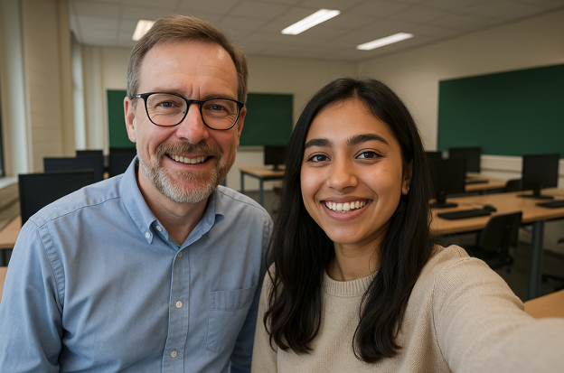

# Interview Klaskompas

Datum: 15 juni 2026
Interviewer: Aylin Vermeer (student)
Geïnterviewde: Erik de Boer (docent)
Locatie: HAN

## Introductie

**Kunt u uzelf kort voorstellen en uw rol binnen de hogeschool toelichten?**

Mijn naam is Erik de Boer en ik ben docent ICT aan de HAN. Ik geef les aan eerste- en tweedejaarsstudenten en begeleid daarnaast enkele projectgroepen.

**Wat is uw motivatie voor het ontwikkelen van deze applicatie?**

Ik merk dat het lastig is om een goed beeld te krijgen van de interesses en achtergrond van mijn studenten. Als ik weet waar ze wonen en wat hun hobby's zijn, kan ik ze persoonlijker benaderen en beter begrijpen waarom bepaalde studenten bijvoorbeeld moeite hebben om op tijd te komen of niet goed integreren in de groep. Ook kan ik betere voorbeelden geven die aansluiten op de dingen die ze leuk vinden. Tenslotte vind ik het leuk om, als ik studenten in groepjes ga indelen, dat te doen op basis van hun eigenschappen. Ik kan me bijvoorbeeld voorstellen dat het leuk is om studenten in te delen op basis van hoe ver ze van school wonen. Ik zie namelijk dat studenten die verder weg wonen heel vaak erg vroeg op school zijn, terwijl studenten die dichtbij wonen soms wat later binnenkomen.

## Huidige situatie

**Hoe verzamelt u momenteel informatie over de studenten?**

Momenteel houd ik dat handmatig bij in een Excel-bestand. Studenten vullen een formulier in op papier en ik typ dat vervolgens over.

**Welke uitdagingen ervaart u daarbij?**

Dit is omslachtig en foutgevoelig en het zorgt er ook voor dat ik niet altijd goede automatische overzichten kan maken. Als ik bijvoorbeeld een typfoutje maak bij het invoeren van een hobby, dan komt die als aparte hobby terug in het overzicht. Een systeem om me daarbij te helpen door te controleren of een ingevoerde hobby wel echt bestaat zou me echt helpen.

## Wensen en functionaliteiten

**Wat zijn de belangrijkste gegevens die u per student wilt vastleggen?**

De naam, afstand tot school, en enkele hobby's. De exacte woonplaats is niet nodig, maar ik wil wel weten hoe ver een student ongeveer van school woont. Deze informatie krijg ik ook van de HAN in een csv-bestand. Het zou fijn zijn als ik die kan inlezen. O ja, en per hobby wil ik ook graag de volgorde bijhouden, zodat ik makkelijk kan zien welke hobby echt de favoriete is van een student en welke hobby's minder belangrijk zijn. Ik denk aan iets van een getal om dat bij te houden, bijvoorbeeld 1 voor de favoriete hobby, 2 voor de hobby die daarna komt, enzovoort.

**Hoe belangrijk is het dat de woonafstand automatisch wordt berekend?**

Dat hoeft niet. Vanwege de AVG krijg ik niet de adressen van studenten, maar wel de afstand tot school in kilometers. Ik zou er wel graag een overzicht van hebben om in te kunnen schatten hoever een student moet reizen. Ook zou ik graag een wijziging kunnen aanbrengen voor als iemand verhuist.

**Wilt u specifieke categorieën voor hobby's of een vrije invuloptie?**

Ik wil de hobby's van tevoren kunnen invullen met wat extra informatie, zoals of het een hobby is die je individueel uitvoert of met meerdere mensen, en een korte omschrijving zodat ik wat dingen kan verduidelijken als dat nodig is. En als die lijst er eenmaal inzit, wil ik kunnen aangeven welke student welke hobby's heeft. En het kan natuurlijk dat ik dan nog nieuwe hobby's wil invoeren, dus ik wil naderhand ook nog nieuwe hobby's kunnen toevoegen. En als een student gestopt is met een hobby, moet ik die hobby natuurlijk kunnen weghalen bij de student.
Ook wil ik een lijst kunnen printen waarin je ziet welke studenten welke hobby's hebben, zodat ik een overzicht kan gebruiken tijdens mijn lessen.

Nu ik erover nadenk is het wel handig om de hobby-gegevens ook in een bestand te kunnen zetten dat ik de eerste keer kan inlezen, zoals ik dat ook met naam en afstand tot school doe. Met daarnaast dus de mogelijkheid om later extra hobby's te kunnen toevoegen.

**Wilt u dat studenten zelf hun gegevens kunnen invoeren of alleen dat u dit als docent beheert?**

Ik wil er graag zelf mee aan de slag. De studenten hoeven dit zelf niet in te kunnen voeren, en deze informatie is ook niet bedoeld om te delen. Ik moet de alle gegevens ook kunnen wissen om te kunnen voldoen aan de AVG-wetgeving. Je hoort wel dat ik dat erg serieus neem!

O ja, ik weet natuurlijk hoe de applicatie werkt, dus je kunt ervan uitgaan dat ik geen dingen ga doen om de applicatie kapot te krijgen, maar het zou wel fijn zijn als ik bij het maken van een typfout een nette foutmelding te zien krijg in plaats van dat de applicatie crasht.

## Gebruik en interactie

**Hoe vaak verwacht u deze applicatie te gebruiken?**

Waarschijnlijk wekelijks, vooral aan het begin van een nieuw semester om mijn studenten goed te leren kennen. En daarnaast wil ik dus makkelijk studenten kunnen indelen in groepjes op basis van hun afstand tot school. De ene keer wil ik de klas indelen in groepjes van 2 of 3, een andere keer misschien in groepjes van 7 of 8. Die functie ga ik waarschijnlijk wel meerdere keren per week gebruiken.

**Wilt u zoek- en filtermogelijkheden om snel studenten te vinden op basis van afstand of hobby's?**

Dat hoeft op zich niet als ik maar een lijst van met de studenten en hun hobby's kan afdrukken, zodat ik kan zien wie er dezelfde hobby heeft. Voor de afstanden zie ik liever iets op het scherm, een grafiekje of iets wat de afstand duidelijk maakt. En natuurlijk iets om studenten in groepen in te delen op basis van de afstand waarop ze wonen.

**Wilt u dat studenten elkaar via de applicatie kunnen bekijken en hun hobby's kunnen vergelijken?**

Nee, dat is op dit moment niet nodig.

## Beheer en onderhoud

**Wie zou de gegevens moeten kunnen aanpassen (alleen u, ook studenten, etc.)?**

Studenten kunnen mij de informatie doorgeven via een mailtje of me aanspreken in de les. Ik wil wel de mogelijkheid hebben om alles in te zien en eventueel wijzigingen te controleren of onjuiste informatie te corrigeren.

**Heeft u specifieke wensen met betrekking tot privacy en beveiliging?**

Ja, in zoverre dat het uitsluitend op mijn pc komt te staan, zodat ik zelf het beheer heb. En dus de mogelijkheid om snel alles te kunnen wissen.

## Toekomstige uitbreidingen

**Zijn er nog andere functionaliteiten die u in de toekomst zou willen toevoegen?**

Misschien een functie waarmee ik eenvoudig notities per student kan toevoegen. Bijvoorbeeld als een student moeite heeft met bepaalde vakken of als ik iets belangrijks over hun persoonlijke situatie moet onthouden. Maar dit mag je voorlopig nog even vergeten, dat komt in een latere versie wel, ook omdat we de veiligheid zelfs nog wat beter op orde moeten hebben. Eerst maar de registratie van de afstand en hobby's goed op orde krijgen.

## Afronding

**Zijn er specifieke voorbeelden van systemen of tools die u prettig vindt en als inspiratie kunnen dienen?**

Niet echt. Hou het vooral simpel.

**Wat zou voor u een succesvolle applicatie betekenen?**

Als ik zonder gedoe kan zien wat de reisafstand van mijn studenten is en welke hobby's ze hebben.

---

Bedankt voor uw tijd en waardevolle input. We gaan nu aan de slag met een conceptontwerp en komen binnenkort bij u terug voor feedback.
