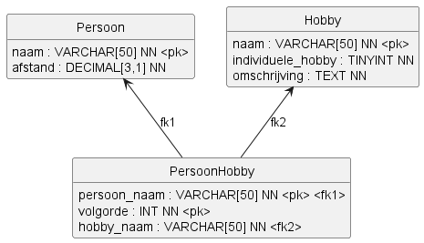
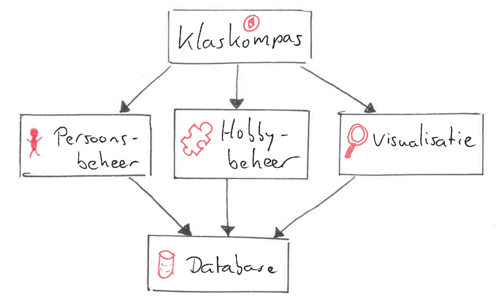

# Ontwerp Klaskompas

## Inleiding

Dit document beschrijft het ontwerp van Klaskompas. Dit ontwerp biedt de technische basis voor de realisatie van de applicatie.

## Tabelontwerp

De database van Klaskompas bestaat uit de volgende tabellen:

## Afhankelijkheden

De applicatie "Klaskompas" is afhankelijk van de volgende bibliotheken:

- `sqlite3` - Voor het opslaan en ophalen van gegevens in de SQLite-database.
- `csv` - Voor het inlezen van brondata uit CSV-bestanden.
- `matplotlib` - Voor het genereren van grafieken (staafdiagrammen en taartdiagram).

## Modules

De applicatie "Klaskompas" bestaat uit de volgende modules:

## Detailontwerp

De applicatie "Klaskompas" bestaat uit de onderstaande elementen.

### Globale variabelen module "Klaskompas"

Geen globale variabelen gedefinieerd in deze module.

### Functies module "Klaskompas"

- `haal_databaseverbinding_op()`: Maakt een SQLite-verbinding, zet foreign keys aan en retourneert de verbinding.

- `main()`: Hoofdfunctie die het menu toont en de programmaloop beheert.

- `maak_groepjes_op_basis_van_afstanden(verbinding)`: Interactieve functie die het aantal groepjes opvraagt en vervolgens groepjes laat maken.

- `vul_database_uit_csvbestand(verbinding)`: Importeert personen en hobby's vanuit CSV-bestanden.

### Functies module "Persoonsbeheer"

- `importeer_personen(verbinding)`: Leest personen-data uit `data/personen.csv` en verwerkt deze naar de database.

- `persoon_aanwezig_in_database(verbinding, naam)`: Controleert of een persoon met de gegeven naam in de database staat.

- `voeg_persoon_toe_aan_database(verbinding, naam, afstand)`: Voegt een persoon toe aan de database.

- `wijzig_afstand_in_database(verbinding, naam, nieuwe_afstand)`: Wijzigt de afstand van een bestaande persoon.

- `verwijder_alle_personen_uit_database(verbinding)`: Verwijdert alle personen uit de database.

- `maak_groepjes_op_basis_van_afstanden(verbinding, aantal_groepjes)`: Deelt personen in groepen op basis van afstand.

- `haal_personen_op_volgorde_van_afstand_uit_database(verbinding)`: Haalt personen op, gesorteerd op afstand.

- `haal_afstanden_per_persoon_op_uit_database(verbinding)`: Haalt naam en afstand per persoon op.

- `toon_grafiek_van_afstanden_als_afbeelding(verbinding)`: Toont een staafdiagram met matplotlib.

- `toon_grafiek_van_afstanden_als_ascii(verbinding, maximale_staaflengte, karakter)`: Toont een ASCII-staafdiagram.

- `werk_afstand_bij_voor_persoon(verbinding)`: Interactieve functie om de afstand van een persoon aan te passen.

- `toon_grafiek_met_afstand_per_persoon(verbinding)`: Interactieve keuzefunctie voor afbeelding of ASCII-grafiek.

### Globale variabelen module "Hobbybeheer"

- `csvbestand_hobbys`: Pad naar het CSV-bestand met hobbygegevens (`data/hobbys.csv`).

### Functies module "Hobbybeheer"

- `importeer_hobbys(verbinding)`: Leest hobby-data uit het CSV-bestand en voegt deze toe aan de database.

- `haal_hobbys_op_uit_database(verbinding)`: Haalt alle hobbynamen op uit de database.

- `voeg_hobby_toe(verbinding)`: Interactieve functie om een hobby toe te voegen.

- `voeg_hobby_toe_aan_database(verbinding, naam, individuele_hobby, omschrijving)`: Voegt een hobbyrecord toe aan de database.

- `print_hobbys(verbinding)`: Print alle hobby's met type en omschrijving.

- `haal_hobby_overzicht_op_uit_database(verbinding)`: Haalt naam, type en omschrijving van hobby's op.

- `hobby_aanwezig_in_database(verbinding, hobby)`: Controleert of een hobby aanwezig is.

- `verwijder_alle_hobbys_uit_database(verbinding)`: Verwijdert alle hobby's uit de database.

### Globale variabelen module "Persoonhobbybeheer"

Geen globale variabelen gedefinieerd in deze module.

### Functies module "Persoonhobbybeheer"

- `koppel_hobby_aan_persoon(verbinding)`: Interactieve functie om een hobby aan een persoon te koppelen.

- `print_personenlijst_met_hobbys(verbinding)`: Print personen met gekoppelde hobby-informatie.

- `haal_personenlijst_met_hobbys_op_uit_database(verbinding)`: Haalt personen met hobbygegevens op via joins.

- `print_personen_met_hobby(verbinding, hobby)`: Print alle personen voor een specifieke hobby.

- `haal_personen_per_hobby_op_uit_database(verbinding, hobby)`: Haalt personen op voor een specifieke hobby.

- `print_personen_per_hobby(verbinding)`: Loopt door alle hobby's en print de bijbehorende personen.

- `koppel_hobby_aan_persoon_in_database(verbinding, naam, hobby, volgorde)`: Slaat de koppeling persoon-hobby op.

- `ontkoppel_hobby_van_persoon(verbinding)`: Interactieve functie om een hobby van een persoon te ontkoppelen.

- `ontkoppel_hobby_van_persoon_in_database(verbinding, naam, hobby)`: Verwijdert een koppeling persoon-hobby.

- `persoon_hobby_combinatie_aanwezig_in_database(verbinding, naam, hobby)`: Controleert of een combinatie al bestaat.

- `volgorde_aanwezig_in_database(verbinding, naam, volgorde)`: Controleert of een volgorde al gebruikt is voor een persoon.

- `print_aantal_personen_per_hobby(verbinding)`: Print per hobby het aantal gekoppelde personen.

- `haal_aantal_personen_per_hobby_op_uit_database(verbinding)`: Haalt aantallen personen per hobby op.

- `haal_favoriete_hobby_aantallen_op_uit_database(verbinding)`: Haalt aantallen op van favoriete hobby's (`volgorde = 1`).

- `verwijder_alle_koppelingen_uit_database(verbinding)`: Verwijdert alle records uit de koppeltabel.

- `toon_taartdiagram_van_favoriete_hobbys(verbinding)`: Toont een taartdiagram van favoriete hobby's.
